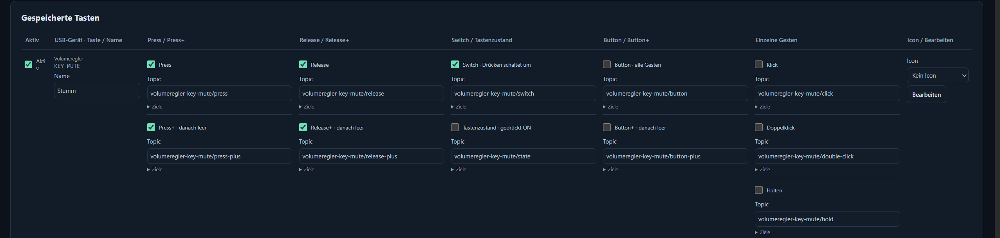
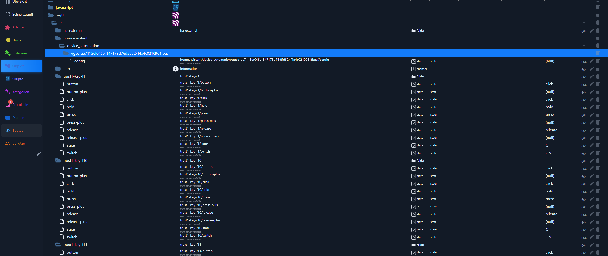

# USB Extender for Home Assistant

**Connect USB input devices and Stream Decks through MQTT — for Raspberry Pi.**

Version **0.1.22** · Public test release · [Deutsch](README.md) · **English** · [Published releases](https://github.com/rockbaer2007/usb-extender-home-assistant/releases/latest)

**Faster imports:** ZIPs and folders commit the icon index once at the end. Browser
folders are bundled locally into one ZIP upload. Originals are checked and stored;
previews and animation frames are generated on first display/use and then cached.
Reimporting existing originals preserves their icon IDs and key mappings.

Single-run comparison on this Windows PC: Itsyhome (240 images) **4.262 → 0.395 s**;
6,800 synthetic PNG icons **458.323 → 10.464 s**. These are not Raspberry Pi results
or a measurement of the user's currently importing 6,800-icon package. Let a running
import finish before installing the update.

Archive imports now show a progress bar with actual server counts, **x of y icons**.
Transfer and initial inspection use an indeterminate bar. Folder uploads also read
`manifest.json` for the readable package title, such as **Fluent UI System Icons
(Filled)**. Folder names and original files remain unchanged. Reimport an existing
package to update its display name without changing its icon IDs.

Licence information is shown once in the package header, with the full text
expandable within the package. Distinct notices are preserved together. Individual
icons have no licence controls. Tiles are 52×52 pixels around 48×48 images;
filenames and animation details remain available on hover or keyboard focus.

The icon library now uses collapsed packages, search and hover/focus previews
showing original filenames. Thumbnails are limited to 48×48 pixels. Original files
keep their names and subfolders under `/var/lib/ugso-usbhub/icons/IconPacks/`;
derived previews are stored separately in `icons/.cache/`. Existing IDs remain
compatible internally. Removing unused packages creates a library backup first;
packages used by saved keys are protected. The header shows free and total data
filesystem space and highlights low space.

GIF and animated WebP icons can animate normally and while pressed: up to 120
frames, minimum frame duration 100 ms (maximum 10 fps). Static icons remain quiet
until changed; backgrounds are static. Older imports discarded all but the first
frame and must be reimported to recover animation. Real tablet testing is pending.

Saved keys start collapsed, showing **Device – Key – Name**. Click a row to open
its settings. Opening another key closes the previous one; click again to close.
Switching entries preserves edits. Use Save at the top to persist them.
Each expanded entry also has Save and Cancel buttons and an unsaved-change
reminder. Save persists all pending settings; Cancel reverts only this key,
preserving edits to other keys.

Each Stream Deck key now supports a second icon and separate background and text
colors while pressed. Releasing restores the normal appearance. Unspecified values
inherit the normal appearance. The pressed preview sends no MQTT actions. Save to
apply the artwork to USB or Mobile decks. Real tablet testing is still pending.

The Stream Deck tab stays visible. Disconnecting shows **Offline** while keeping
the editor, selected key and unsaved text. Status changes no longer rebuild the
form. Saved device geometry allows later offline editing; Mobile keeps its last
grid in the server registry too.

Mobile: change rows/columns in the **Android app** only. Its reported grid is
adopted without disconnecting. The incorrect editor override from 0.1.14 is removed;
old values are retained but ignored. Offline retains the last app-reported grid.
Empty WebSocket Pings every five seconds replace the too-late 15-second keepalive,
without sending any extra images. Unsupported optional shortcut messages no longer
disconnect the session. The Mobile page shows the latest disconnect reason.

Mobile red/blue channels corrected. Identical pixels and display metadata are
not retransmitted; the Mobile connection view shows actual transmission counts.
Check on the tablet whether this also resolves the reported blinking.

After enabling a Stream Deck and clicking **Speichern**, all missing key rows
receive press/release, press-plus/release-plus, switch (toggle), state (down/up),
button/button-plus, click/double-click/hold channels automatically. Example:
`stream-deck-mobile-key-0/press`. Edit each row in the key list. Existing rows,
custom topics and additional individual actions remain; individual actions send
in addition to generated channels. Works for Mobile and physical decks.

Mobile handshake: Android requires Stream Deck 6.3 or newer in the desktop-version
field. We incorrectly sent our own product version. Since 0.1.12 this field
advertises protocol compatibility 6.3.0; the UI retains the actual USB Extender
version. This is still a limited interoperable server, not the full desktop app.
After updating, fully close and reopen Android. Saved trust and settings remain.

Icon library: **Dateien importieren** imports one or several images. Select
**Ganzer Ordner auf diesem Computer**, then **Ordner importieren** to upload a
PC folder including subfolders. Its name becomes the collection. Progress and
skipped files are shown. Limits: 10,000 files/96 MB per selection, 8 MB per image.
Existing icons/settings are preserved. Pi-local folder paths and ZIP/Elgato
icon packs remain supported.

Unchanged Mobile icons are no longer retransmitted repeatedly. Top/bottom text
gets its own area and the foreground icon shrinks to fit. Center text continues
to overlay the icon. This applies to previews, USB decks and Mobile.

Illustrated documentation: [English](https://opensource.ugso-software.de/en/projects/usb-extender/)
· [German](https://opensource.ugso-software.de/projects/usb-extender/)
· [French](https://opensource.ugso-software.de/fr/projects/usb-extender/).
The application interface currently uses German labels; the screenshots show that interface.

A Raspberry Pi 4 receives USB keyboard/media-key events and sends them to up to
**three independent MQTT brokers**, including Home Assistant and ioBroker at the
same time. The password-protected web interface is for configuration and can be
stopped completely. USB input and MQTT continue in a separate service.

This is an independent project, not official Home Assistant or Elgato software.
It is an input-to-MQTT bridge, **not a general USB-over-IP tunnel**.



## Device discovery versus working support

Linux can list many connected USB devices. Being listed does not mean that a
device's protocol is supported. A matching driver and your explicit input
permission are required before events become MQTT messages.

| Device class | Available functionality | Verification |
| --- | --- | --- |
| USB keyboards, including Windows multimedia keyboards | Press/release, click/double-click/hold, toggling switch, pressed-state channel | Trust/HCT keyboards used in the practical setup |
| Media/volume keys | `KEY_VOLUMEUP`, `KEY_VOLUMEDOWN`, `KEY_MUTE`; other reported media keys; configurable volume repeat | Volume/mute inputs observed; test other keys per model |
| HID macro pads, USB pedals and keyboard-like devices | Existing input path if Linux reports normal key codes | Model-dependent; reports welcome |
| Physical Elgato Stream Decks | Dedicated HID driver, display and input features below | Implemented; no physical Stream Deck tested in this project yet |
| Other LCD-key devices resembling a Stream Deck | Keyboard events may work through HID; displays require their own protocol/driver | No blanket compatibility claim |
| Printers, cameras, storage, audio interfaces, serial devices and other controllers | Inventory listing; specific functionality needs a separate adapter | No general print/camera/audio/MIDI/serial forwarding |
| Stream Deck Mobile / tablet app | Optional experimental VSD2 network server with QR pairing | User confirms pairing/deck opening and icon display; further practical checks pending |

### Stream Deck features

- Key press/release/hold and single/double-click recognition, with per-key MQTT routing.
- Custom icons and text on supported display keys; brightness per device.
- MQTT state feedback can change an active icon; targeted display commands are supported.
- On models with dials: rotation direction and dial presses as events.
- On touchscreen models: touch events, **not** a freely designed touchscreen layout.
- Local icon folders, individual images, ZIP files and locally obtained `.streamDeckIconPack` archives.
  Respect each pack's licence; no Marketplace content is bundled. GIF and animated WebP preserve frames.
- Models without displays, such as Pedal, provide input but do not show display-key icons.

The included `python-elgato-streamdeck` 0.10.0 driver supports models including
Original/MK.2, Mini, XL, Neo, Pedal and Plus. This is a driver capability list,
**not a hardware-tested list for this project**. There is one fixed key layout;
profile/page switching is not implemented. Animated key icons are locally supported since 0.1.18.

## Installation and updates

Recommended: Raspberry Pi 4, Raspberry Pi OS Lite **64-bit Bookworm or newer**,
Python 3.11+, systemd, sudo and internet access for apt/PyPI. A powered USB hub may
be needed for multiple display devices. 32-bit Pi OS has not been practically verified.
The ZIP is an installation package, not an offline firmware image.

```bash
sudo apt-get update && sudo apt-get install -y unzip
unzip USB-Extender-Home-Assistant-0.1.22-Raspi4.zip
cd USB-Extender-Home-Assistant-0.1.22
sudo bash install.sh
```

The installer shows nine steps: system/package checks, missing dependencies,
backup, service account/data directory, isolated Python installation, validation,
USB permissions, systemd startup and final status. Existing settings are retained.
It backs up existing data under `/var/backups/` and can restore the previous
program link if the update fails. For an update, extract the new ZIP separately
and run its installer again.

Set a web password when prompted, or run `sudo usb-extender password`. There is
no installed default password. Start the web UI with `sudo usb-extender web start`
and open `http://<raspberry-pi-address>:8098` in your browser.

## First setup and learning

1. Open **MQTT-Broker**, configure up to three brokers and save. Enable HA discovery
   on HA brokers; select **Aus – nur MQTT-Daten senden** for ioBroker.
2. Open **USB-Geräte**, name and explicitly enable the input device, select its
   destination brokers and save. Inventory detection alone does not enable input.
3. Open **Tasten & Anzeigen**, select the device and click **Anlernen starten**.
4. Press and release each wanted key once. Existing assignments and repeated
   presses are not added twice. The selected device does not send actions while learning.
5. Click **Anlernen beenden**, then **Tasten übernehmen**, then **Speichern**.
6. Edit individual names, topics, icons and channel checkboxes in the saved list.
   **Bearbeiten** opens per-key routing, switch behaviour and timing options.

If the browser disconnects, learning expires within 15 seconds. Unsaved learning
drafts remain in the browser only. Existing individual bindings stay available.

## Topics and payloads

New keys receive readable topics such as `trust-keyboard-key-f1/press`. Device
names become MQTT-safe slugs; duplicate names receive readable numeric suffixes.
Saved topics remain stable when the display name is later changed. Explicit
topics have the same name on every selected broker.

| Topic suffix | Payload / behaviour |
| --- | --- |
| `/press` | `press` when pressed |
| `/release` | `release` when released |
| `/press-plus`, `/release-plus` | Same action, then an empty payload after 50 ms |
| `/switch` | First press `ON`, next press `OFF`; release does not toggle |
| `/state` | `ON` while pressed, `OFF` after release |
| `/button` | `click`, `double_click` or `hold` |
| `/button-plus` | Same button event, then an empty payload after 50 ms |
| `/click`, `/double-click`, `/hold` | The respective individual gesture |

All eleven channels are prepared and enabled for newly learned keys. New extra
channels on existing rows remain disabled until selected. Original topics and
plus behaviour on older rows are retained. From 0.1.5, Switch defaults to toggling;
the former momentary mode remains an explicit compatibility option.

Single-click waits for the double-click window (default 300 ms after release).
Double-click does not also send a single-click. Hold fires once after 700 ms and
does not produce a click on release. Holding the second press replaces the
pending click sequence with hold. These times are configurable per key.

Volume keys default to repeating active Press/Press+ channels after 500 ms, every
150 ms while held. Release, Switch and button gestures are not repeated by this
mechanism. It stops on release, known device removal, configuration reload and
after 30 seconds. Your HA/ioBroker automation determines the volume step.

Switch values persist in `switches.json` and are synchronized after reconnecting.
Data messages use QoS 0, are not retained, and offline key events are not replayed.
The UI's “passed to MQTT” indication confirms local publication acceptance, not
broker receipt or the creation of a downstream entity.

## Optional Stream Deck Mobile server (0.1.7)

**Experimental:** the user confirms pairing/deck opening and an imported icon
on Android. Layout matching and full MQTT interaction still need practical checks.
A local protocol peer tests encrypted pairing, image transmission, key events and MQTT.
The server has no purchase/Pro tier and does not change the app's own restrictions.
One page, configurable 1–8 columns/rows (up to 64 keys), default 5 columns × 3 rows
from 0.1.9. Existing settings are preserved. When Android reports its layout, the
editor follows it; server defaults do not change the Android app's own grid.

1. Update using the new ZIP and `sudo bash install.sh`; settings are backed up and retained.
2. Open **Mobile-Server** in the web UI. This feature is disabled by default.
3. Enter the Pi's reachable IPv4 address or hostname (not `127.0.0.1` for a phone),
   keep port **28198** or choose another free port. **Rastervorgabe** supplies a
   fallback for clients without their own grid; change Android's grid in the app.
4. Check **Stream-Deck-Mobile-Server aktivieren**, click the top **Speichern** button,
   and wait for **Mobile-Dienst aktiv**. A port conflict leaves USB/MQTT running.
5. Click **Kopplung starten · QR-Code** to allow pairing for two minutes. Choose
   Add computer in Android and scan the QR code. Confirm the expected device and
   six-character hexadecimal fingerprint with **Gerät vertrauen**, or reject it.
6. Create/open a virtual deck in Android. Enable and save the new device under
   **USB-Geräte** or **Stream Deck**, then assign artwork and MQTT actions. Existing
   learned key rows and gestures can also be used. Scanning alone enables no actions.
   Since 0.1.8, the confirmation is available as soon as the client greets the
   server, including clients that send their Authenticate request later.
   From 0.1.9 a new Mobile deck automatically opens the graphical editor when
   there are no unsaved drafts or learning sessions to interrupt. MQTT inputs
   still need explicit permission. Changing fallback grid settings keeps the
   connection and opened deck alive, without selecting the deck again in Android.
7. Uncheck the activation checkbox and save to close the Mobile port/connections;
   USB and MQTT remain active. Configuration and trusted clients are retained.

The server runs inside the core daemon, independently of the optional web UI.
The UI is required for new pairing confirmations, and can be stopped afterwards.
No Bonjour/cloud discovery server is implemented; pairing uses direct QR endpoints.
The Android Pro status and its design filter were inspected statically; see
`docs/MOBILE-PROTOKOLL.md`. Other online/purchase checks remain incompletely assessed. Android controls its own
screen brightness. App-side deletion of virtual decks is not implemented; data is retained.

Server identity, trusted clients, virtual devices and short-lived pairing controls
are stored in `mobile-identity.json`, `mobile-trust.json`, `mobile-devices.json` and
`mobile-control.json` inside the data directory. CLI backups include them; ZIPs do not.
Private server keys are never returned to the browser. The protocol findings are
recorded in [MOBILE-PROTOKOLL.md](docs/MOBILE-PROTOKOLL.md).

## Graphical Stream Deck tab (0.1.6)

The **Stream Deck** tab stays visible, including offline. Connect a device once
to read its actual hardware metadata and keep its editor available afterwards.
Enable the device and save first. Its driver then provides
the actual model, key count and layout; USB permission errors are shown rather than
guessing a layout.

1. Select the device and click a key in its graphical layout.
2. Pick a foreground icon and optional background image from the icon library.
   **Bilder importieren …** opens the existing image importer.
3. Set background colour, label, text colour, size and position. Contain keeps
   the complete foreground image; Cover fills the key and crops its edges.
4. Edit existing individual MQTT actions or add Press/Release/Hold actions with
   a topic, payload and target brokers. Added actions run alongside existing ones.
   Learned keys retain their channels under **Tasten & Anzeigen**.
   Since 0.1.13, enabling/saving a deck automatically fills missing standard key
   rows. No individual actions are needed for the eleven standard channels.
5. For state feedback, choose the device's receive broker and set a state topic,
   optional JSON field, active value and active icon on its action. Received values
   remain the displayed text, as before.
6. Click the top **Speichern** button to apply the changes to the USB/MQTT service.

The preview shares the hardware image renderer and never publishes MQTT actions.
Artwork is stored separately from mappings. Unplugging shows Offline and retains
the tab, editor and settings for reconnection. A Pedal offers MQTT mappings but no image editor.
Pages and a graphical touch-strip editor are not included.

The new tab has automated simulated-device and local Chrome checks. Physical
Stream Deck operation on a Pi still needs practical verification.

## Home Assistant and ioBroker integration

HA discovery groups all keys of a USB device under the same stable device
identifier and selected device name. Actions are device triggers with payload
filters; Switch and pressed state are separate binary sensors. An automation or
mapping is needed to control another device — the binary sensor is a state indicator.

In ioBroker, keep HA discovery off and use the MQTT topics. The MQTT adapter can
create separate states when their first messages arrive. Empty plus-channel
resets appear as `(null)` in the supplied practical setup; this is expected.
Discovery configuration messages themselves remain JSON, as required by HA.



The user's 0.1.5 screenshots show three broker profiles online, function-key
messages, individual ioBroker states and HA Switch/pressed-state values after
key use. They visibly include `press`, `release`, `click`, `hold`, `ON` and `OFF`.
They do not establish every function on every physical device. Double-click,
restart persistence and failure paths have automated tests; physical Stream Deck
verification remains open. There are **61 Python tests** plus JavaScript/DOM checks.

## Web UI and backups

```bash
sudo usb-extender web start
sudo usb-extender web stop
sudo usb-extender web status
sudo usb-extender web enable
sudo usb-extender web disable
sudo usb-extender backup
sudo journalctl -u ugso-usbhub -n 50
```

Closing a browser tab does not stop the web service; `web stop` closes the HTTP
listener while USB/MQTT keep running. The data directory is
`/var/lib/ugso-usbhub/`; the previous ten configuration versions are backed up
automatically. Full CLI backups also include icons and saved switch state.
The internal service name remains `ugso-usbhub`.

Use HTTP only in a trusted local network, or put it behind VPN/HTTPS. Do not
expose the interface directly to the internet. The service's Linux `input` group
access is wider than the app's per-device software permission. MQTT credentials
must be locally readable for connections; configuration files and backups are
restricted, and passwords are not returned by the web configuration API.

## Please test your Stream Deck or similar device

[Submit a hardware test](https://github.com/rockbaer2007/usb-extender-home-assistant/issues/new?template=hardware-test.yml).
Please include the exact model/revision, Pi model, OS and app version. Explain
whether the device is merely listed or actually produces key codes, and which
features work: press/release, click/double-click/hold, icons/text, brightness,
dials, touch and unplug/replug. For other LCD-key devices, a report may help assess
whether a separate adapter can be written; it does not imply existing support.

Use a harmless MQTT topic first, without controlling real devices. Screenshots
of inventory and input events help. Do not publish passwords, tokens,
`config.json` or backup archives. Bug reports and contributions are welcome.

More: [Changelog](CHANGELOG.md) · [Roadmap](ROADMAP.md) · [Test report, German](TESTBERICHT.md).
The new `docs/screenshots/live-0.1.5/` images are user-supplied practical screenshots;
older `*-demo.jpg` files show synthetic local data. Dependencies and iconpacks
retain their respective licences. No third-party Marketplace content is bundled.
