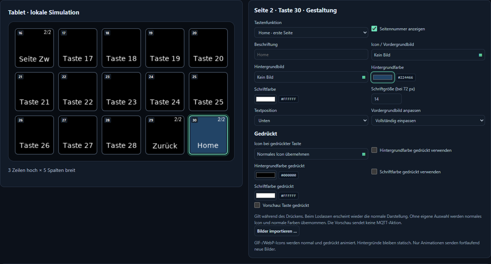
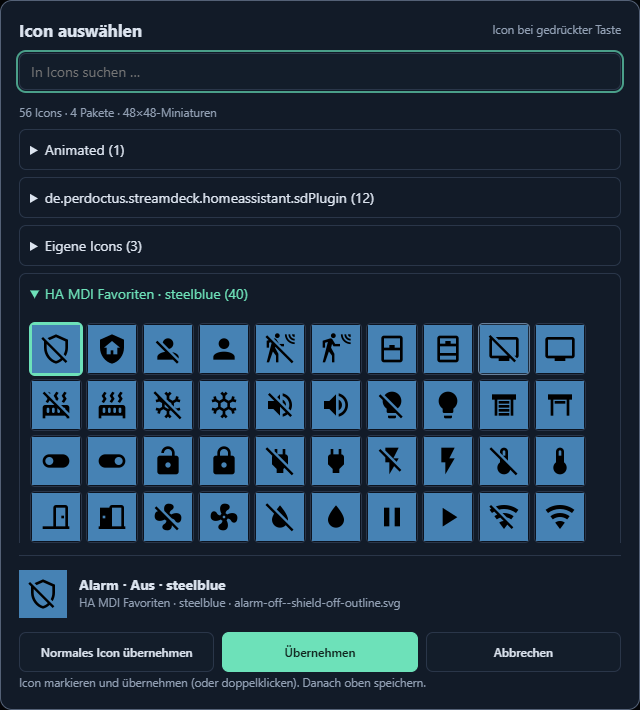
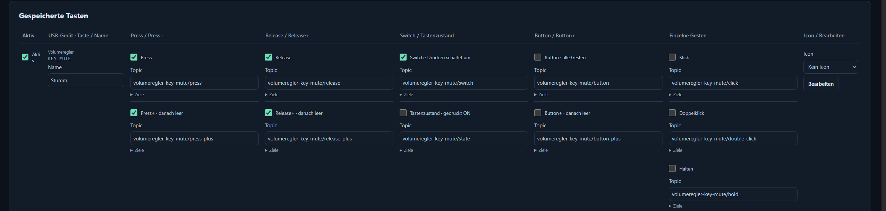
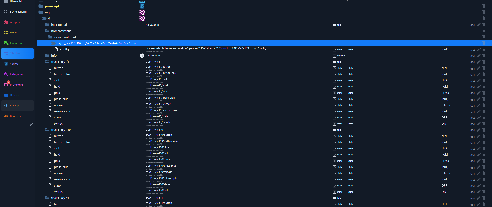
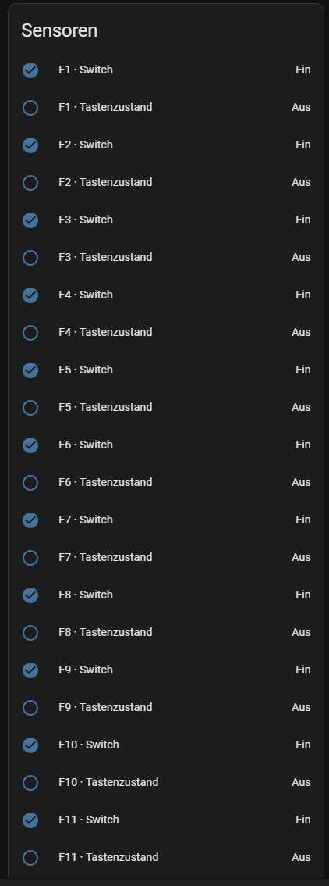

# USB Extender für Home Assistant

**USB-Geräte und Stream Decks über MQTT verbinden – für Raspberry Pi.**

Version **0.1.28** · Öffentliches Testrelease · Stand 22. November 2026 · [ZIP herunterladen](https://github.com/rockbaer2007/usb-extender-home-assistant/releases/tag/v0.1.28)

0.1.28 teilt die Mobile-Bildübertragung bei Seitenwechseln in kleine Pakete,
damit der Empfang von Eingaben und die Verbindungspflege dazwischen weiterlaufen.
Das Dienstprotokoll enthält zusätzliche Angaben zu Verbindungsabbrüchen.
**15-Minuten-Praxistest bestanden:** SM-T580, 8×8 und zwei Seiten, zunächst
mehrfach Vor/Zurück, anschließend rund 14 Minuten Leerlauf. Das Tablet blieb in
allen 16 Messpunkten verbunden, Ping/Pong stieg von 56/56 auf 232/232.
Im abschließenden Journal gab es keinen neuen Heartbeat-Timeout und keine
Trennung. Im Leerlauf blieben Bild- und Metadatenzähler konstant.
[Messwerte und Testgrenzen](docs/tests/mobile-0.1.28-15min-20261122.md).
Das Ergebnis gilt für diesen Aufbau und Zeitraum; Bildschirmabschaltung,
App-Hintergrundbetrieb und andere Netzbedingungen wurden nicht geprüft.

**USB / Virtuelle Geräte und Deck-Seiten:** Im Gerätebereich werden USB-Geräte
und gekoppelte virtuelle Mobile-Decks gemeinsam verwaltet. Jedes Deck erhält bis
zu **acht eigene Seiten**, unabhängig von anderen Geräten.

1. Im Stream-Deck-Editor **Neue Seite** wählen. Die neue Seite wird sofort im
   Editor geöffnet. Das Raster kommt weiterhin vom Gerät bzw. der Android-App.
2. Tasten werden fortlaufend nummeriert: bei 15 Tasten 1–15, dann 16–30 usw.
   Jede Seite hat eigene Gestaltung und MQTT-Zuordnungen.
3. Unter **Tastenfunktion** zwischen **MQTT / normale Taste**, **Vor**, **Zurück**
   und **Home** wählen. Mit **Gehe zu** zusätzlich die gewünschte **Zielseite**
   auswählen. Nach **Speichern** navigieren diese Tasten direkt am Tablet.
   Beim Löschen der Zielseite führt der Sprung auf Seite 1; nachfolgende
   Zielseiten werden nachgeführt. Navigationstasten senden keine MQTT-Aktion; bisherige
   Zuordnungen bleiben gespeichert und werden beim Zurückstellen auf MQTT wieder aktiv.
4. **Seitennummer anzeigen** blendet einen kleinen Zähler wie 2/3 auf der Taste
   ein. Bei Navigationstasten ist er zunächst eingeschaltet. **Home** führt auf
   Seite 1; Vor/Zurück bleiben an der ersten/letzten Seite stehen.
5. **Aktuelle Seite löschen** entfernt nach Rückfrage deren Gestaltung und
   Belegungen. **Seite 1 bleibt geschützt.** Die übrigen Seiten behalten ihre
   IDs und Topics, auch wenn sich ihre sichtbare Seiten-/Tastennummer verschiebt.
6. Oben **Speichern**. Vorher bleibt die gespeicherte Gerätekonfiguration erhalten.

Die Editorbuttons Vor/Zurück/Home wechseln nur die Vorschau. Auf dem Deck dienen
die entsprechend zugewiesenen Tasten zur Navigation; Mobile-Seitenbefehle werden
ebenfalls verarbeitet. Im Verbindungsstatus steht die am Gerät aktive Seite.
Nach Dienstneustart startet jedes Deck auf Seite 1. Beim Seitenwechsel werden
gehaltene Tasten und offene Klickfolgen beendet; Rückmeldungen anderer Seiten
überschreiben nicht die sichtbare Seite. Die Gestaltungsfelder sind kompakter,
Farbfelder zeigen eine kleine Auswahl und den Hexwert.

Neue MQTT-Kanäle weiterer Seiten haben einen stabilen Seitenteil, z. B.
`tablet-page-2-key-0/press`. Die Topics werden beim Löschen einer anderen Seite
bewusst nicht umbenannt. Die bisherigen Topics von Seite 1 bleiben erhalten.
Die Seitenfunktionen sind lokal mit Protokollsimulation geprüft; Vor/Zurück und
Leerlauf wurden außerdem am echten SM-T580 erfolgreich getestet. Neue Seite,
Löschen, Home und Gehe zu sind lokal geprüft; deren vollständiger Hardwaretest
sowie physische Stream Decks bleiben weitere Prüfpunkte.



**Grafische Iconauswahl:** Im Stream-Deck-Editor, in der Tastenliste und bei
MQTT-Rückmeldungen öffnet der Iconbutton ein kompaktes Auswahlfenster statt einer
langen Dropdownliste. Pakete aufklappen, nach Name/Dateiname/Schlagwort suchen,
Icon markieren und **Übernehmen** wählen (oder doppelklicken). **Abbrechen** und
Escape behalten die bisherige Auswahl. Anschließend oben **Speichern**.

Es werden ausschließlich **48×48-PNG-Miniaturen** für die Auswahl geladen, bei
Animationen nur das erste Bild. Kein Decodieren aller GIF-/WebP-Bilder für den
Auswahldialog. Miniaturen entstehen bei Bedarf unter `icons/.cache/thumbnails/`
und werden auf dem Pi sowie im angemeldeten Browser wiederverwendet. Nur sichtbare
Kacheln werden geladen; pro geöffnetem Paket stehen höchstens 96 Kacheln je Seite.
Die Vollbilder und Animationen für das tatsächliche Deck bleiben unverändert.
Die Bibliotheksdaten übertragen gleiche Paketlizenztexte nur einmal.
Der Such-/Auswahlindex zeigt gleiche Icon-IDs **je Paket nur einmal**, auch bei
mehreren Dateinamen oder wiederholten Einträgen. Alternative Namen bleiben in der
Suche und im Hovertext erhalten. Originaldateien und gespeicherte IDs werden nicht
gelöscht oder umgeschrieben. Unterschiedliche Stile sowie Schwarz/Weiß bleiben getrennt.



**MDI-Favoriten:** Unter **Iconbibliothek** übernimmt **MDI-Favoriten hinzufügen ·
40 Icons** ein mitgeliefertes Offline-Paket in SteelBlue: 20 Ein-/Aus-Paare für
übliche HA-Entitäten. Kein automatischer Import und keine Änderung der Belegungen.
Erneutes Hinzufügen erhält IDs und Zuordnungen. Im Editor selbst als normal/gedrückt
oder über MQTT-Rückmeldung zuweisen; die Bilder erzeugen keine HA-Zustandsbindung.

Zusätzlich wurden 147 Farbsets mit den gelieferten CSS-Farben erstellt, jeweils
40 SVGs in 48×48 mit kontrastierenden schwarzen/weißen Symbolen. Je Farb-ZIP
einzeln importieren, nicht den gesamten Ausgabeordner samt entpackten Duplikaten.
Die Ein-/Aus-Varianten haben lesbare Dateinamen und stehen kompakt in einem Raster. Bei Tür/Fenster/Rollladen
bedeutet das offen/geschlossen, bei Schloss verriegelt/entriegelt und bei Medien
Wiedergabe/Pause. Suche unterstützt deutsche/englische Begriffe und MDI-Namen.
Paketlizenzen: Pictogrammers MDI 7.4.47 (Apache-2.0), CSS Color Icons von Crafty Lime
(MIT). Originalquellen und Lizenztexte unter `tools/mdi-favorites-source/`.
Reproduzierbar offline erzeugen:

```bash
python tools/build_mdi_favorites.py --output /neuer/ordner/HA-MDI-Favoriten
```

Vorhandene Ausgabeordner werden nicht überschrieben. Das Standardpaket wird auch
im Python-Paket mitgeliefert; die übrigen Farben müssen nicht auf die SD-Karte.

**Schneller Paketimport:** Ein ZIP bzw. ein Ordner schreibt den Iconindex nur einmal
am Ende. Browser-Ordner werden lokal zu einem gemeinsamen ZIP gebündelt statt als
tausende Einzelanfragen gesendet. Originale werden geprüft und gespeichert;
Vorschauen, Animationseinzelbilder und WebP-Vorschauen entstehen erst beim ersten
Anzeigen oder Verwenden eines Icons und werden danach wiederverwendet.
Bestehende Icon-IDs und Tastenzuordnungen bleiben beim erneuten Import erhalten.

Lokaler Einzelvergleich auf diesem Windows-PC: Itsyhome (240 Bilder) **4,262 →
0,395 Sekunden**, 6.800 synthetische PNG-Testicons **458,323 → 10,464 Sekunden**.
Das sind keine Raspberry-Pi-Messungen und nicht das aktuell beim Nutzer laufende
6.800er-Paket. Laufenden Import erst beenden lassen, danach aktualisieren.

Beim Paketimport zeigt ein Ladebalken den tatsächlichen Stand **x von y Icons**.
Während der Übertragung und Paketprüfung läuft er zunächst ohne Prozentangabe.
Beim Hochladen ganzer Ordner liest die Oberfläche `manifest.json`, damit der
lesbare Paketname erscheint (etwa **Fluent UI System Icons (Filled)**).
Ordnername und Originaldateien bleiben erhalten. Bereits importierte Pakete für
die aktualisierte Namensanzeige erneut importieren; bestehende Icon-IDs bleiben gleich.

Die vorhandene Lizenz steht einmal im Paketkopf; der vollständige Text lässt sich
im Paket aufklappen. Unterschiedliche Lizenzhinweise bleiben gemeinsam erhalten.
Einzelne Icons haben keine Lizenzbedienelemente mehr. 48×48-Icons sitzen in
kompakten 52×52-Kacheln; Dateinamen und Animationshinweise erscheinen beim Hover.

Die **Iconbibliothek** zeigt zunächst geschlossene Pakete mit Anzahl. Suche nach
Dateiname, Paket, Unterordner oder Schlagwort; beim Darüberfahren bzw. Tastaturfokus
erscheint eine größere Vorschau mit Originaldateiname und Paketname. Miniaturen
sind höchstens 48×48 Pixel groß. Neue Originaldateien bleiben unter
`/var/lib/ugso-usbhub/icons/IconPacks/<Paketordner>/…` mit Namen und Unterordnern
erhalten. Technische Vorschaudaten liegen getrennt in `icons/.cache/`, der Index
in `icons/index.json`. Frühere Icon-Zuordnungen bleiben lesbar.

GIF und animiertes WebP können normal und gedrückt animiert angezeigt werden.
Maximal 120 Einzelbilder, Bildabstand mindestens 100 ms (höchstens 10 Bilder/s).
Statische Icons werden weiterhin nur bei Änderungen übertragen. Hintergründe
bleiben statisch. Bereits früher auf ein Einzelbild reduzierte Imports benötigen
einen erneuten Import aus dem Originalpaket.

**Paket entfernen** sichert vorher die Bibliothek; noch verwendete Pakete werden
nicht entfernt. Im Kopf stehen freier und gesamter Speicher des Datenlaufwerks.
Bei knappem Speicher ist die Anzeige rot; zu große Imports werden abgelehnt.
Der echte Animationstest auf dem Tablet steht noch aus.

Die gespeicherten Tasten sind zunächst eingeklappt: **Gerätename – Key – Name**.
Eine Zeile anklicken, um ihre Einstellungen zu öffnen. Beim Öffnen einer anderen
Taste klappt die vorherige zu. Erneuter Klick schließt den Eintrag. Änderungen
bleiben beim Wechsel erhalten; zum dauerhaften Übernehmen oben speichern.
Im geöffneten Eintrag stehen zusätzlich **Speichern** und **Abbrechen**.
Ein Hinweis und eine Markierung zeigen ungespeicherte Änderungen. Speichern
übernimmt alle geänderten Einstellungen. Abbrechen setzt ausschließlich diese
Taste zurück; Änderungen an anderen Tasten bleiben erhalten.

Unter **Gedrückt** im Stream-Deck-Editor je Taste ein zweites Icon sowie eigene
Hintergrund- und Schriftfarben wählen. Beim Loslassen erscheint wieder die normale
Darstellung. Ohne eigene Auswahl werden normale Werte übernommen. **Vorschau:
Taste gedrückt** sendet kein MQTT. Oben speichern, um die Gestaltung auf USB- und
Mobile-Decks anzuwenden. Die vollständige Hardwareprüfung aller eigenen
Gedrückt-Icon-/Farbkombinationen bleibt offen.

Der Stream-Deck-Tab bleibt sichtbar. Bei Verbindungstrennung zeigt er **Offline**
und behält Tastenansicht, Auswahl und ungespeicherte Texte. Statuswechsel ersetzen
den Editor nicht mehr. Gespeicherte Gerätegeometrie erlaubt späteres Offline-
Bearbeiten; ein Mobile-Deck merkt sich sein Raster auch im Serverregister.

Mobile: Zeilen und Spalten ausschließlich in der **Android-App** ändern. Das
App-Raster wird ohne Verbindungstrennung übernommen. Die falsche Editor-
Übersteuerung aus 0.1.14 ist entfernt; alte Werte bleiben gespeichert, aber inaktiv.
Offline bleibt das zuletzt von der App gemeldete Raster erhalten.
Leere WebSocket-Pings alle fünf Sekunden verhindern das zu späte Keepalive des
bisherigen 15-Sekunden-Intervalls. Das erzeugt keine Bildaktualisierungen.
Optionale, nicht unterstützte Shortcut-Nachrichten schließen die Sitzung nicht
mehr. Unter Mobile-Verbindungen steht die letzte Trennung mit ihrem Grund.

Mobile-Farben: Rot/Blau in komprimierten Tablet-Bildern korrigiert. Identische
Bildpixel und Anzeige-Metadaten werden nicht erneut gesendet. Unter Mobile-
Verbindungen zeigen Zähler den tatsächlichen Versand; ohne Änderungen bleiben
sie stehen. Ob damit auch das gemeldete Blinken aufhört, ist am Tablet zu prüfen.

Stream-Deck-Tasten erhalten nach Freigabe und **Speichern** automatisch die elf
bekannten Kanäle: press/release, press-plus/release-plus, switch (Umschalter),
state (gedrückt/losgelassen), button/button-plus, click/double-click/hold.
Beispiel: `stream-deck-mobile-key-0/press`. Alle Tasten sind anschließend in der
Tastenliste einzeln editierbar. Bestehende Zeilen/Topics bleiben erhalten;
zusätzliche Einzelaktionen senden weiterhin zusätzlich. MQTT-Freigabe bleibt
ausdrücklich erforderlich. Gilt für Mobile und physische Stream Decks.

Mobile-Verbindung: Die Android-Meldung „Stream Deck mindestens 6.3“ wurde durch
unsere Produktversion im falschen Protokollfeld ausgelöst. Ab 0.1.12 wird dort
die Kompatibilitätsangabe 6.3.0 gesendet, während die Oberfläche weiterhin die
echte USB-Extender-Version zeigt. Kein vollständiger Stream-Deck-Desktopnachbau.
Nach dem Update die Android-App vollständig schließen und wieder öffnen;
gespeicherte Kopplung und Einstellungen bleiben erhalten.

Iconbibliothek: einzelne oder mehrere Bilder mit **Dateien importieren** laden.
Für komplette PC-Ordner **Ganzer Ordner auf diesem Computer** auswählen und
**Ordner importieren** anklicken. Unterordner werden mitgelesen; der gewählte
Ordnername wird zur Sammlung. Fortschritt und übersprungene Dateien werden
angezeigt. Maximal 10.000 Dateien/96 MB je Auswahl, 8 MB je Bild. Vorhandene Icons
und Einstellungen bleiben erhalten. Der Import eines Ordners auf dem Raspi
über dessen Pfad sowie ZIP-/Elgato-Iconpacks bleiben ebenfalls verfügbar.

Mobile: Unveränderte Icons werden nicht ständig erneut übertragen. Text oben/unten
erhält einen eigenen Bereich; das Vordergrundicon wird passend verkleinert.
Text mittig bleibt über dem Icon. Gilt für Vorschau, USB-Deck und Mobile.

**Deutsch** · [English](README.en.md) · [ZIP herunterladen](https://github.com/rockbaer2007/usb-extender-home-assistant/releases/latest)

Bedienungsanleitung mit Bildern: [DE](https://opensource.ugso-software.de/projects/usb-extender/)
· [EN](https://opensource.ugso-software.de/en/projects/usb-extender/)
· [FR](https://opensource.ugso-software.de/fr/projects/usb-extender/).

Ein Raspberry Pi 4 wird zur USB-/MQTT-Brücke: Tastaturen, Medientasten,
Makropads und unterstützte physische Stream Decks liefern Eingaben an bis zu
drei unabhängige MQTT-Broker. Die Weboberfläche dient nur zur Einrichtung und
lässt sich vollständig abschalten. Der USB-/MQTT-Dienst arbeitet weiter.

Eigenständiges Projekt, keine offizielle Software von Home Assistant oder Elgato.



## Welche Geräte werden erkannt und genutzt?

**USB-Erkennung ist nicht gleich Funktionsunterstützung.** Der Pi listet angeschlossene
USB-Geräte aus dem Linux-System auf. Erst ein passender Eingabetreiber und deine
ausdrückliche Freigabe machen ein Gerät zur MQTT-Eingabequelle. Das Programm ist
kein USB-over-IP-Tunnel und leitet keine beliebigen USB-Protokolle weiter.

| Geräteklasse | Was möglich ist | Stand |
| --- | --- | --- |
| USB-Tastaturen, auch Windows-Medientastaturen | Tasten, Press/Release, Klick/Doppelklick/Hold, Umschalter, Tastenzustand | Trust-/HCT-Tastaturen im Praxisaufbau genutzt |
| Medien- und Lautstärketasten | `KEY_VOLUMEUP`, `KEY_VOLUMEDOWN`, `KEY_MUTE`; weitere vom Gerät gemeldete Play-/Titeltasten; Lautstärkewiederholung beim Halten | Lautstärke-/Stummeingaben beobachtet; weitere Tasten je Modell testen |
| HID-Makropads, USB-Fußtaster und ähnliche Tastaturgeräte | Derselbe Eingabepfad, wenn Linux normale Tastencodes liefert | Modellabhängig, Rückmeldungen willkommen |
| Physische Elgato Stream Decks | Eigener HID-Treiber; Funktionen unten | Implementiert, noch kein physisches Stream Deck in diesem Projekt geprüft |
| Stream-Deck-ähnliche Geräte mit LCD-Tasten | Tastatureingaben eventuell über HID; Displayansteuerung nur mit passendem Herstellerprotokoll/Treiber | Keine pauschale Kompatibilitätszusage |
| Drucker, Kameras, USB-Speicher, Audiointerfaces, serielle Geräte, weitere Controller | Bestandsanzeige; spezielle Nutzfunktionen brauchen eigene Adapter | Keine allgemeine Druck-, Kamera-, Audio-, MIDI- oder serielle Weiterleitung |
| Stream Deck Mobile / Tablet-App | Optionaler experimenteller VSD2-Netzwerkserver, QR-Kopplung | Kopplung/Decköffnung und Iconanzeige vom Nutzer bestätigt; weitere Praxistests offen |

### Stream Deck: Welche Funktionen sind vorgesehen?

- Tasten drücken, loslassen, halten, Einzel-/Doppelklick und MQTT-Zielwahl pro Taste.
- Eigene Icons und Beschriftungen auf unterstützten **Displaytasten**, Helligkeit pro Gerät.
- Aktives/anderes Icon über MQTT-Zustandsrückmeldung sowie gezielte Displayaufträge.
- Bei Modellen mit Drehreglern: Drehrichtung und Reglerdruck als Ereignisse.
- Bei Modellen mit Touchscreen: Touch-Ereignisse; kein frei gestaltbarer Touchscreen-Editor.
- Iconbibliothek: eigene Ordner/Bilder sowie lokal vorhandene `.streamDeckIconPack`- oder ZIP-Pakete.
  Nutzungsrechte der jeweiligen Iconpacks beachten; keine Marketplace-Pakete im Download enthalten.
- Modelle ohne Display, etwa Pedal, liefern Eingaben, aber keine Display-Icons.

Der eingebundene Treiber `python-elgato-streamdeck` 0.10.0 kennt unter anderem
Original/MK.2, Mini, XL, Neo, Pedal und Plus. Das ist **keine bestätigte Hardware-
Testliste** dieses Projekts. Deck-Seiten sind ab 0.1.26 lokal implementiert;
zusätzliche Profile bleiben offen. Animierte Tastenicons sind ab 0.1.18 lokal implementiert.

## Im Paket

- Anlernmodus pro USB-Gerät mit editierbarer Tastenliste: Press, Release,
  Switch ON/OFF, optionale Leer-Rücksetzung und Lautstärkewiederholung.
- Installer mit neun sichtbaren Schritten und Paketprüfung. Fehlende apt- und
  Python-Pakete werden installiert; bestehende Konfiguration wird gesichert.
- Drei getrennte MQTT-Verbindungen mit Benutzer/Passwort, optional TLS und
  eigener CA-Datei; automatische Wiederverbindung je Broker.
- Zielauswahl pro Gerät und pro Tastenbelegung. Eine Taste kann an mehrere
  Broker senden. Pro Gerät genau ein Broker für Display-Rückmeldungen.
- USB-Bestandsliste; Freigabe jeder Eingabequelle ausdrücklich in der Oberfläche.
- Tasten drücken/loslassen/halten, gedrosselte Wiederholung und relative
  Drehbewegungen, soweit das Gerät sie über evdev bzw. den Stream-Deck-Treiber liefert.
- Stream-Deck-Tasten mit eigenen Icons, Text und Helligkeit; Zustandsanzeige über
  ein MQTT-Topic oder einen gezielten Displayauftrag.
- Iconbibliothek mit lokalem Ordnerimport, Einzelbildern, ZIP und lokal vorliegenden
  `.streamDeckIconPack`-Dateien im ZIP-Format. Name, Sammlung, Tags, Autor und
  Lizenztext bleiben verfügbar.
- Home-Assistant-MQTT-Geräteauslöser über Discovery für angelegte Belegungen.
- Passwortgeschützte Konfiguration; atomare Speicherung und zehn automatische
  Konfigurationssicherungen. MQTT-Passwörter werden nicht an den Browser zurückgeliefert.

## Tasten anlernen (ab 0.1.3)

1. Unter **USB / Virtuelle Geräte** das Gerät freigeben, seine Zielbroker wählen und speichern.
2. Unter **Tasten & Anzeigen** das Gerät wählen und **Anlernen starten** drücken.
3. Gewünschte Tasten nacheinander drücken und loslassen. Jede neue Taste erscheint
   einmal als Listenzeile; bereits vorhandene Belegungen werden nicht verdoppelt.
4. **Anlernen beenden**, dann **Tasten übernehmen** und **Speichern**.
   Alternativ die neue Liste verwerfen. Erst gespeicherte Zeilen senden MQTT.
5. Name, Aktivierung, Topics und Icon direkt in der Liste anpassen. **Bearbeiten**
   öffnet die Brokerwahl und bei Lauter/Leiser die Wiederholungszeiten.

Während des Anlernens sendet das gewählte Gerät keine Aktionen; andere Geräte
laufen weiter. Bei geschlossener oder unerreichbarer Weboberfläche endet diese
Pause spätestens nach 15 Sekunden. Anlernentwürfe liegen bis zur Übernahme nur
im Browser; vorhandene Einstellungen und Einzelbelegungen bleiben erhalten.

| Kanal | Nachricht | Vorgabe |
| --- | --- | --- |
| Press | `press` beim Drücken | an |
| Release | `release` beim Loslassen | an |
| Switch | Erstes Drücken `ON`, nächstes Drücken `OFF` | an |
| Press+ | Eigener Kanal: `press`, nach 50 ms leer zurücksetzen | an |
| Release+ | Eigener Kanal: `release`, nach 50 ms leer zurücksetzen | an |
| Tastenzustand | `/state`: `ON` beim Drücken, `OFF` beim Loslassen | an |
| Button | `/button`: `click`, `double_click` oder `hold` | an |
| Button+ | `/button-plus`: gleiche Aktion, danach nach 50 ms leer | an |
| Einzelne Gesten | `/click`, `/double-click`, `/hold`: jeweilige Aktion | an |

Ab 0.1.4 sind die ersten fünf Topics beim Anlernen mit lesbaren Namen ausgefüllt:
`trust-keyboard-key-f1/press`, `/release`, `/switch`, `/press-plus` und `/release-plus`.
Sie gehen mit identischem Namen an alle gewählten Broker. In MQTT ist `+` ein
Platzhalter; deshalb heißen die Plus-Topics ausdrücklich `press-plus`/`release-plus`.
Zusätzlich gibt es ab 0.1.5 die sechs weiteren Kanäle aus der Tabelle. Nur die
Plus-Kanäle werden leer zurückgesetzt; normale Press-/Release-/Button-Kanäle
bleiben unverändert. Die Leer-Nachricht ist kein physisches Loslassen.

Gerätenamen werden MQTT-tauglich umgewandelt, etwa „Büro Tastatur“ zu
`buero-tastatur`. Gleiche Gerätenamen erhalten bei Bedarf `-2`, `-3` usw.
Nach dem Speichern bleiben Topics auch bei einer späteren Umbenennung stabil.
Die technische Gerätekennung wird weiterhin intern verwendet und steht nicht
im neuen Daten-Topic. Bestehende Einzelbelegungen und Tasten aus 0.1.3 behalten
ihre bisherigen Topics und ihre ursprüngliche Plus-Funktion; keine stille Umstellung.

**Switch ist ab 0.1.5 ein Umschalter:** Loslassen verändert seinen Zustand nicht.
Der Wert steht in `switches.json`, überlebt einen App-Neustart und wird beim
MQTT-Wiederverbinden erneut als aktueller Zustand gesendet (nicht retained).
Bei Bedarf lässt sich unter **Bearbeiten → Switch-Verhalten** der bisherige
Momenttaster-Modus wählen. Der neue Kanal **Tastenzustand** erfüllt diese Aufgabe
separat. Zusatzkanäle vorhandener Zeilen starten ausgeschaltet; neue Anlerntasten
haben alle elf Kanäle vorbereitet und eingeschaltet.

**Button-Gesten:** Einzelklick wird nach dem Doppelklick-Fenster (Vorgabe 300 ms
ab Loslassen) gesendet. Ein zweiter Klick innerhalb dieses Fensters ergibt nur
`double_click`. Halten ab 700 ms sendet `hold` genau einmal; beim Loslassen folgt
kein Klick. Wird der zweite Druck gehalten, ersetzt Hold die noch wartende
Klickfolge. Native Tastaturwiederholungen zählen nicht als weitere Klicks und
schalten Switch nicht erneut um. Beide Zeiten sind pro Taste unter **Bearbeiten**
einstellbar. Alle Kanäle können unabhängig genutzt werden; mehrere zugeordnete
Automationen lösen entsprechend auch mehrere Aktionen aus.

Die Oberfläche verwendet die verfügbare Fensterbreite. Press, Release,
Switch/Tastenzustand, gemeinsame Button-Ereignisse und einzelne Gesten stehen
gruppiert nebeneinander. Auf schmalen Fenstern lässt sich nur die Tabelle
horizontal scrollen. Die Broker-Ziele sind pro Kanal aufklappbar.
Alle Tastenmeldungen bleiben QoS 0 und nicht retained; Offline-Eingaben werden
nicht nachgesendet. Die Anzeige „übergeben“ bestätigt die lokale MQTT-Übergabe,
nicht den Empfang oder die Entitätsanlage im Zielsystem.

**Lauter/Leiser:** `KEY_VOLUMEUP` und `KEY_VOLUMEDOWN` starten beim Anlernen mit
Wiederholung an: nach 500 ms alle 150 ms eine weitere Press-Nachricht. Zeiten sind
einstellbar; aktive Press- und Press+-Kanäle werden wiederholt. Release, Switch
und vorhandene Einzelbelegungen werden dadurch nicht wiederholt.
Loslassen, Abziehen und eine Konfigurationsübernahme beenden die
Wiederholung. Nach 30 Sekunden greift ein Sicherheitsstopp. Das Gerät muss
Drücken und Loslassen zuverlässig melden. Den Lautstärkeschritt und die
Zielaktion legt die HA-Automation bzw. ioBroker-Logik fest.

Bei aktivierter HA-Discovery werden Press/Release als Geräteauslöser mit passendem
Payloadfilter und Switch als MQTT-Binärsensor angemeldet. Der Binärsensor zeigt
die gedrückte Taste an; zum Steuern anderer Geräte ist eine Zuordnung/Automation
erforderlich. Alle Tasten, Plus-Auslöser und Switch-Binärsensoren eines USB-Geräts
teilen dieselbe stabile Gerätekennung und den gewählten Gerätenamen. Eine
Namensänderung erzeugt dadurch kein neues Gerät. Für ioBroker Discovery
ausgeschaltet lassen und die MQTT-Topics
verwenden. Der neue Nutzertest zeigt dort einzelne Datenpunkte mit einfachen
Werten. Discovery-Konfigurationen selbst sind weiterhin JSON, wie von HA erwartet.

## Praxisnachweis 0.1.5

Die vom Nutzer bereitgestellten Screenshots zeigen 0.1.5 mit drei als online
gemeldeten Brokerplätzen, gespeicherten Funktionstasten und erfolgreichen
Zustandsanzeigen in HA sowie einzelnen ioBroker-Datenpunkten. `press`, `release`,
`click`, `hold`, `ON` und `OFF` sind sichtbar. Plus-Kanäle erscheinen nach der leeren
Rücksetzung in ioBroker als `(null)`; das ist in diesem Aufbau erwartbar.





Der Ereignisverlauf zeigt die Übergabe an HA, IOB und Testserver. Diese
Übergabeanzeige allein ist kein Empfangsnachweis für alle drei Broker. Die
HA-/ioBroker-Screenshots sind der zusätzliche sichtbare Nachweis. Doppelklick,
Neustartpersistenz und Fehlerfälle sind automatisiert geprüft; die Bilder belegen
keinen vollständigen Hardwaretest aller Funktionen und insbesondere kein Stream Deck.

## Installation auf dem Raspberry Pi

Empfohlen: **Raspberry Pi OS Lite 64 Bit, Bookworm oder neuer**, Raspberry Pi 4,
Python mindestens 3.11, Internetzugang für apt und PyPI. Auch die Installation
auf 32-Bit-Pi-OS ist vorgesehen, aber noch nicht praktisch geprüft. Eine laufende
systemd-Installation und sudo-Rechte werden benötigt. Das ZIP ist ein
Installationspaket, kein vollständig offline installierbares ARM-Abbild.

1. ZIP auf den Pi kopieren, beispielsweise in den Home-Ordner.
2. Terminal oder SSH öffnen und ausführen:

   ```bash
   # Falls unzip noch nicht vorhanden ist:
   sudo apt-get update && sudo apt-get install -y unzip
   unzip USB-Extender-Home-Assistant-0.1.28-Raspi4.zip
   cd USB-Extender-Home-Assistant-0.1.28
   sudo bash install.sh
   ```

3. Den Installer durchlaufen lassen. Er zeigt vorhandene und fehlende Pakete,
   installiert Abhängigkeiten in einer eigenen Python-Umgebung und fragt bei der
   ersten interaktiven Installation nach einem Webpasswort mit mindestens zwölf
   Zeichen. Ohne interaktives Terminal anschließend setzen:

   ```bash
   sudo usb-extender password
   ```

4. Weboberfläche starten:

   ```bash
   sudo usb-extender web start
   ```

5. `http://<IP-des-Raspi>:8098` im Browser öffnen und anmelden. Die IP zeigt
   `hostname -I`. Keine spitzen Klammern in die Adresse übernehmen.

Der Installer aktiviert **nur den USB-/MQTT-Dienst automatisch beim Booten**.
Bei einer Neuinstallation bleibt der Webdienst zunächst aus. Bei einer späteren
Installation bleiben Daten und ein bereits laufender Webdienst erhalten.

### Die neun Installationsschritte

1. Linux, Architektur, systemd und Paketinhalt prüfen.
2. Vorhandene Systempakete auflisten und Fehlendes installieren.
3. Dienste für eine konsistente Sicherung stoppen und bestehende Daten sichern.
4. Separates Dienstkonto und Datenordner anlegen.
5. Neue Programmversion samt eigener Python-Umgebung installieren.
6. Python-Bibliotheken einschließlich SVG-Rasterung und Konfiguration prüfen.
7. USB-Berechtigungen und zwei getrennte systemd-Dienste einrichten.
8. USB-/MQTT-Dienst starten und aktiven Status prüfen.
9. Abschlussübersicht mit Adresse und Bedienbefehlen anzeigen.

Schlägt ein Update fehl, werden vorher laufende Dienste wieder gestartet; nach
einem bereits erfolgten Programmwechsel wird der alte Programmverweis zurückgesetzt.
Die Datensicherung liegt unter `/var/backups/`. Programmversionen werden unter
`/opt/ugso-usbhub/releases/` getrennt abgelegt. Es wird keine vorhandene Konfiguration
durch eine Demokonfiguration ersetzt.

## Erstes Gerät einrichten

### 1. MQTT-Broker

Unter **MQTT-Broker** einen Platz aktivieren. Host, Port und gegebenenfalls
Benutzer/Passwort eintragen. Ein eigenes, eindeutiges Topic-Präfix wählen.
Bei mehreren Extendern dürfen deren Präfixe auf demselben Broker nicht kollidieren.
TLS prüft Zertifikate; eine eigene CA-Datei kann auf dem Pi hinterlegt werden.
Ein leer gelassenes Passwortfeld erhält ein bereits gespeichertes Passwort.
Die separate Checkbox löscht es ausdrücklich.

**Discovery ist von der Datenübertragung getrennt.** Für jeden Broker gibt es
die Auswahl **Aus – nur MQTT-Daten senden** oder **Home Assistant – Geräteauslöser
anmelden**. Für ioBroker zunächst **Aus** wählen; MQTT-Ereignisse werden trotzdem
gesendet. Die verwendete HA-Discovery-Komponente `device_automation` wird nicht
von jedem ioBroker-Discovery-Adapter unterstützt. Neue Profile starten mit Discovery aus;
bestehende Profile werden nicht ungefragt umgestellt.

Beim Abschalten nimmt der Extender bekannte eigene retained Discovery-Ankündigungen
zurück. Bereits bekannte Namen bleiben lokal in `discovery.json` gespeichert,
damit die Bereinigung bei einem Verbindungsabbruch wiederholt werden kann.
Für den Wechsel von 0.1.0/0.1.1 werden eigene Zuordnungen aus den letzten zehn
Konfigurationssicherungen berücksichtigt. Fremde Discovery-Topics werden nicht gelöscht.

Unter **Vorgabe für neue Geräte** die gewünschten Broker ankreuzen. Speichern.

**Beispiel: ioBroker produktiv und Testsystem gleichzeitig.** Broker 1 mit dem
MQTT-Server des Produktivsystems verbinden, Broker 2 mit dem MQTT-Server des
Testsystems. An Gerät oder Belegung beide Ziele ankreuzen. Für identische Topics
bei beiden dasselbe Präfix oder in der Belegung ein festes Sende-Topic setzen.
Die Eingabe-Payload ist dann bytegleich. Die Übertragungen laufen unabhängig,
aber ohne Garantie auf exakt gleichzeitige Ankunft. Bei Ausfall eines Brokers
empfangen die anderen weiter; ausgefallene Eingaben werden nicht nachgesendet.
Dieselben Zugangsdaten sind nicht erforderlich. Wenn zwei Plätze auf denselben
MQTT-Server mit demselben Topic zeigen, entstehen doppelte Nachrichten.

### 2. USB-Gerät freigeben

Gerät einstecken, **USB / Virtuelle Geräte** öffnen. Bei neu eingesteckten Geräten die Seite
über einen anderen Menüpunkt erneut aufrufen. Die Bestandsliste wird im Dienst
alle fünf Sekunden erneuert. Namen vergeben, **Gerät für Eingaben freigeben**
aktivieren, MQTT-Ziele wählen, speichern.

Wichtig: Eine freigegebene Tastatur kann auch normale Buchstaben liefern.
Nur dedizierte Eingabegeräte freigeben, nicht die Tastatur für persönliche Eingaben.
Es wird kein Linux-Eingabegerät exklusiv gesperrt; das Betriebssystem kann weiterhin
darauf reagieren. Zwei Treiber verarbeiten dasselbe Stream Deck nicht parallel.

Geräte werden nach USB-Hersteller-/Produkt-ID und, wenn vorhanden, Seriennummer
erkannt. Ohne USB-Seriennummer gehört die Zuordnung zum physischen USB-Port:
nach Umstecken gegebenenfalls neu zuordnen. Mehrere gleichartige Geräte bleiben
an unterschiedlichen Ports unterscheidbar. Stream Decks ohne USB-Seriennummer
werden zusätzlich über ihren aktuellen libusb-Bus-/Adresspfad geöffnet.

### 3. Taste belegen

**Tasten & Anzeigen** öffnen, am Gerät drücken und neben dem passenden Ereignis
**Übernehmen** wählen. Die Ereignistabelle zeigt nur freigegebene Eingabegeräte.
Beispiele:

| Steuerelement | Bedeutung |
|---|---|
| `KEY_PLAYPAUSE` | Wiedergabe / Pause |
| `KEY_VOLUMEUP`, `KEY_VOLUMEDOWN` | Lautstärke |
| `KEY_MUTE` | Stumm |
| `KEY_NEXTSONG`, `KEY_PREVIOUSSONG`, `KEY_STOPCD` | Mediensteuerung |
| `key:0` | Erste Stream-Deck-Taste, Zählung beginnt bei null |
| `dial:0` | Erster Stream-Deck-Drehregler, sofern unterstützt |
| `touchscreen` | Touch-Ereignis eines unterstützten Stream Decks |

**Drücken** und **Gedrückt halten** sind getrennte Ereignisse; Halten löst nach
0,7 Sekunden zusätzlich zum ersten Drücken aus. Wiederholungen werden auf etwa
sechs pro Sekunde begrenzt. Es gibt derzeit keine Doppelklick-Erkennung.

Normalerweise die Geräteziele übernehmen. Alternativ die Checkbox ausschalten
und einzelne Zielbroker ankreuzen. Ein eigenes Topic und eine feste Payload sind
optional. Die tatsächlichen Zielbroker und vollständigen Sende-Topics werden direkt
in der Belegung angezeigt. Für Tastaturen heißen die Steuerelemente beispielsweise
`KEY_TAB`. Die Schreibweisen `key:tab` und `key_tab` werden beim Speichern
vereinheitlicht. Bei Stream Decks bleibt die erste Taste `key:0`.

Ohne Vorgabe sendet der Dienst ein JSON-Ereignis auf:

```text
<Topic-Präfix>/event/<Geräte-ID>/<Belegungs-ID>
```

```json
{"device":"Geräte-ID","control":"key:0","event_type":"press","value":1}
```

Eingaben verwenden QoS 0, niemals retained. Bei nicht verbundenem Broker wird
keine Eingabe für später gespeichert. Das ist keine Exactly-once-Zustellung.
Zwei vorhandene Brokerverbindungen arbeiten weiter, wenn die dritte ausfällt.

In der Ereignistabelle zeigt die Spalte **MQTT** den Sendestatus und die Ziele.
Bei **Keine passende gespeicherte Belegung** die passende Eingabe übernehmen und
speichern. Bei **Kein MQTT-Ziel ausgewählt** mindestens einen Broker ankreuzen.
Bei **Ziel deaktiviert oder nicht verbunden** die Brokerverbindung prüfen.
**An MQTT übergeben** bestätigt die lokale Übergabe an den MQTT-Client (QoS 0);
ein Empfang im MQTT Explorer bestätigt zusätzlich die Ankunft am Broker.

### 4. Mit Home Assistant verbinden

Home Assistant muss über seine MQTT-Integration mit dem gewünschten Broker
verbunden sein. Bei aktivierter Discovery erscheinen die gespeicherten
Tastenbelegungen als MQTT-Geräteauslöser. In einer HA-Automation das USB-Gerät
und die passende Taste wählen und die gewünschte HA-Aktion ergänzen.

Alternativ einen MQTT-Auslöser mit dem in der Belegung festgelegten Topic benutzen.
Der Extender benötigt keinen Home-Assistant-Zugriffstoken. Er führt selbst keine
frei eingegebenen Shellbefehle aus und verändert keine HA-Systemdateien.

## Stream-Deck-Icons und Zustände

### Optionaler Stream-Deck-Mobile-Server ab 0.1.7

**Experimentell:** Kopplung/Decköffnung und ein sichtbares importiertes Icon sind
vom Nutzer auf Android bestätigt. Rasterabgleich und vollständige MQTT-Bedienung
sind weiter praktisch zu prüfen. Ein unabhängiger Protokollsimulator prüft
QR-Daten, verschlüsselte Kopplung, Bilder, Tasten und MQTT. Es gibt
keine Kaufoption oder Pro-Stufe im Server; eigene Beschränkungen der Android-App
werden nicht aufgehoben. Das Raster wird von Android bis 8×8 übernommen; bis zur
ersten Rastermeldung gilt für neue Geräte **5 Spalten × 3 Zeilen**. Je Deck sind
bis zu acht Seiten möglich. Das Raster direkt in Android einstellen; der Editor
überschreibt die App-Ansicht nicht. Vorhandene Einstellungen bleiben erhalten.

1. Neues ZIP auf den Pi kopieren und wie unten beschrieben mit `sudo bash install.sh`
   aktualisieren. Der Installer sichert bestehende Daten und erhält Einstellungen.
2. Weboberfläche öffnen und **Mobile-Server** wählen. Bei erstmaliger Einrichtung
   ist der Server aus; eine gespeicherte Aktivierung bleibt bei Updates erhalten.
3. Die im WLAN/LAN erreichbare **IPv4-Adresse oder den Hostnamen des Raspberry Pi**
   eintragen. Nicht `127.0.0.1` verwenden, wenn Android auf einem anderen Gerät läuft.
   Standardport ist **28198**, getrennt von der Weboberfläche auf 8098.
4. Das Android-Raster direkt in der App ändern.
   **Stream-Deck-Mobile-Server aktivieren**
   anhaken und oben **Speichern**. Auf **Mobile-Dienst aktiv** warten. Ein belegter
   Port wird als Fehler angezeigt und beendet nicht den USB-/MQTT-Dienst.
5. **Kopplung starten · QR-Code** öffnet ein Kopplungsfenster von zwei Minuten.
   In der Android-App **Computer hinzufügen** wählen und diesen QR-Code scannen.
6. Die Anfrage erscheint mit Gerätenamen und sechsstelligen hexadezimalen
   Prüfabdruck. Nur das eigene erwartete Gerät mit **Gerät vertrauen** bestätigen;
   alternativ ablehnen. Der QR-Scan allein gibt keine MQTT-Steuerung frei.
   Ab 0.1.8 erscheint die Bestätigung bereits nach der Begrüßung, auch wenn das
   Tablet seine zusätzliche Authentifizierungsnachricht erst später sendet.
7. In Android ein virtuelles Deck anlegen bzw. auswählen. Es erscheint unter
   **USB / Virtuelle Geräte** und im grafischen **Stream Deck**-Tab. Gerät dort freigeben und
   speichern, dann Icons gestalten und MQTT-Aktionen zuordnen. Auch das bisherige
   Anlernen mit Press/Release, Switch und Button-Gesten kann genutzt werden.
   Bei einem neu verbundenen Mobile-Deck öffnet sich der Editor automatisch, sofern
   kein ungespeicherter Entwurf oder Anlernvorgang unterbrochen würde. MQTT wird
   dadurch nicht automatisch freigegeben. Rasteränderungen in Android werden ohne
   erneute Kopplung übernommen. Neue Deck-Seiten werden separat im Editor verwaltet.
8. Zum Ausschalten die Server-Checkbox abwählen und speichern. Der separate
   Mobile-Port und seine Verbindungen werden geschlossen; USB/MQTT bleiben aktiv.

Nach erfolgreicher Kopplung kann die Konfigurations-Weboberfläche per CLI gestoppt
werden; der Mobile-Server läuft im USB-/MQTT-Dienst weiter. Für neue Kopplungen ist
die Weboberfläche zur Bestätigung wieder erforderlich. Kein Bonjour-/Cloud-
Discovery-Dienst implementiert: die Einrichtung erfolgt direkt über den QR-Code.
Der Android-Pro-Status und sein Designfilter wurden statisch untersucht; siehe
`docs/MOBILE-PROTOKOLL.md`. Weitere Online-/Kaufprüfungen sind nicht vollständig untersucht.

Die Daten liegen neben der bisherigen Konfiguration: `mobile-identity.json`
(privater Serverschlüssel), `mobile-trust.json` (bestätigte Clients),
`mobile-devices.json` (virtuelle Decks) und `mobile-control.json` (kurzzeitige
Kopplungsfreigabe). Die vorhandene CLI-Sicherung umfasst diese Dateien. Schlüssel
werden nicht an den Browser zurückgeliefert; die Update-ZIP enthält keine davon.
Vertrauen und Deck-IDs bleiben nach einem Dienstneustart erhalten. Android regelt
seine Bildschirmhelligkeit selbst. Entfernen eines virtuellen Decks über die App
ist noch nicht umgesetzt; der Server erhält dessen Daten.

Technische Befunde und Grenzen: [Mobile-Protokoll](docs/MOBILE-PROTOKOLL.md).

### Grafischer Stream-Deck-Tab ab 0.1.6

Der Tab **Stream Deck** bleibt dauerhaft sichtbar. Bei der ersten Verbindung
das Gerät freigeben und speichern;
danach liefert der Treiber das echte Modell, die Tastenanzahl und das Raster.
Bei fehlenden USB-Rechten erscheint ein Hinweis statt eines erfundenen Layouts.

1. Im Tab das Gerät auswählen, dann eine Taste im Gerätebild anklicken.
2. Icon und optional Hintergrundbild aus der Iconbibliothek auswählen. Eigene
   Bilder lassen sich über **Bilder importieren …** hinzufügen.
3. Hintergrundfarbe, Beschriftung, Schriftfarbe, Schriftgröße und Textposition
   einstellen. Einpassen erhält das ganze Vordergrundbild; Füllen schneidet es zu.
4. Unter **MQTT-Zuordnung** vorhandene Einzelaktionen bearbeiten oder eine Aktion
   für Drücken, Loslassen oder Halten hinzufügen: Topic, Nutzdaten und Zielbroker.
   Eine zusätzliche Aktion sendet zusätzlich zu vorhandenen Belegungen. Bereits
   angelernte Tasten bleiben in **Tasten & Anzeigen** mit ihren Kanälen erhalten.
   Ab 0.1.13 werden fehlende Standard-Tastenzeilen nach Freigabe/Speichern
   automatisch ergänzt. Für die elf normalen Kanäle sind keine Einzelaktionen nötig.
5. Für Zustandsanzeigen den Empfangsbroker am Gerät und in der Aktion das
   Zustands-Topic, optional JSON-Feld, aktiven Wert und aktives Icon einstellen.
   Der empfangene Wert wird wie bisher als Text angezeigt.
6. Oben **Speichern**. Erst dann übernimmt der USB-/MQTT-Dienst die Änderungen.

Die Vorschau nutzt dieselbe Bildaufbereitung wie die Hardware und sendet keine
MQTT-Aktion. Gestaltung und MQTT-Belegungen werden getrennt gespeichert. Abziehen
zeigt Offline; Editor und Einstellungen bleiben für das erneute Anschließen erhalten.
Ein Pedal ohne Display bietet MQTT-Zuordnung, keine Bildgestaltung.
Deck-Seiten sind vorhanden; ein grafischer Touchstreifen-Editor ist nicht enthalten.

Automatisierte Hardware-Simulation und lokaler Chrome-Test liegen vor. Der neue
Tab ist noch nicht mit einem physischen Stream Deck auf dem Pi bestätigt.

Unter **Iconbibliothek** eigene Dateien oder ein lokal vorliegendes Paket importieren.
Unterstützt: PNG, JPG/JPEG, SVG, GIF und WebP. Originale bleiben erhalten,
Vorschaudaten werden auf 256×256 normalisiert. GIF-/WebP-Animationen behalten ihre
Bildfolgen mit den oben genannten Grenzen; der Treiber passt sie an das Gerät an.

Für einen Ordner auf dem Pi zum Beispiel:

```bash
sudo mkdir -p /var/lib/ugso-usbhub/import/meine-icons
# Bilder dorthin kopieren und für das Dienstkonto lesbar machen:
sudo chown -R ugso-usbhub:ugso-usbhub /var/lib/ugso-usbhub/import
sudo usb-extender icons /var/lib/ugso-usbhub/import/meine-icons
```

Oder den Ordnerpfad in der Weboberfläche eintragen. Ein privater Home-Ordner ist
gegebenenfalls für das Dienstkonto nicht lesbar; dann den obigen Importordner nutzen.
Die Dateien werden in die verwaltete Bibliothek kopiert. Der Ursprungsordner muss
danach nicht dauerhaft verfügbar sein.

### Elgato-Iconpacks

Lokale `.streamDeckIconPack`-Archive bzw. ZIP-Dateien können importiert werden.
Der Import liest `manifest.json`, `icons.json`, `icons/` und gegebenenfalls
`license.txt`. Eigene Bild-ZIPs benötigen diese Metadaten nicht. Archive werden
nicht ungeprüft entpackt oder ausgeführt; Pfadwechsel und Symlinks werden abgewiesen.
Grenzen: 32 MB Upload, 96 MB entpackt, 10.000 Einträge und 8 MB je Datei.

SVGs mit Skripten, externen Ressourcen oder eingebetteten Stylesheets werden
abgewiesen. Solche SVGs vorher lokal nach PNG konvertieren. Ein Importbericht
zeigt übersprungene Dateien. Ein proprietäres Nicht-ZIP-Paket wird nicht unterstützt.

Es gibt keine Marketplace-Anmeldung und keinen automatischen Download.
Packs selbst rechtmäßig herunterladen bzw. aus der lokalen Stream-Deck-Installation
übernehmen und deren Lizenz beachten. Kein gekauftes Drittanbieter-Pack liegt
diesem Projekt bei. Die Prüfung erfolgte zunächst mit eigenen Icons und einem
Testpaket im dokumentierten Elgato-Format, nicht mit jedem Marketplace-Pack.

### Anzeige einrichten

In einer Stream-Deck-Belegung Icon und Text wählen. Am Gerät einen
**Broker für Display-Rückmeldungen** auswählen. Eine Zustandsbelegung kann zum
Beispiel auf `haus/licht/state` hören, bei `ON` ein aktives Icon anzeigen und sonst
das normale Icon. Für JSON-Antworten kann ein Feldpfad wie `light.state` angegeben
werden. Hier sind exakte Topics vorgesehen, keine Wildcard-Zustandsfilter.
Home Assistant muss den Zustand ausdrücklich auf dieses MQTT-Topic veröffentlichen.

Ein direkter Displayauftrag hat das Topic:

```text
<Topic-Präfix>/display/<Geräte-ID>/set
```

```json
{"key":0,"text":"Licht an","icon":"Icon-ID aus der Bibliothek","brightness":40}
```

Nur der am Gerät eingestellte Empfangsbroker darf die Anzeige ändern. Andere
Broker werden für dieses Gerät ignoriert. MQTT darf keine beliebigen Datei-/URL-
oder Befehlszugriffe auslösen. Gespeicherte Grundbelegungen werden beim Wiederanstecken
geladen; aktuelle Zustände sollte HA retained veröffentlichen, damit sie nach einem
Neustart wieder eintreffen.

## Weboberfläche abschalten

```bash
sudo usb-extender web start      # jetzt starten
sudo usb-extender web stop       # jetzt stoppen: HTTP-Listener beendet
sudo usb-extender web status     # systemd-Status
sudo usb-extender web enable     # jetzt starten und bei jedem Boot
sudo usb-extender web disable    # jetzt stoppen und Autostart entfernen
```

Das Schließen des Browserfensters beendet den Webdienst nicht. `web stop` beendet
nur die Weboberfläche, nicht USB und MQTT. Status und die letzten 100 Eingaben
liegen im regulären Dienstbetrieb im RAM unter `/run/ugso-usbhub/status.json`.
Der zyklische Status erzeugt dadurch keine dauerhaften Schreibzugriffe auf die SD-Karte.

## Status, Sicherung und Update

```bash
sudo usb-extender status
sudo usb-extender devices
sudo usb-extender backup
sudo journalctl -u ugso-usbhub -n 50
sudo systemctl restart ugso-usbhub
```

`backup` erstellt eine geschützte TAR.GZ unter `/var/lib/ugso-usbhub/exports/` mit
Einstellungen, Zugangsdaten, Icons und Konfigurationssicherungen. Diese Datei
vertraulich behandeln. Vor einer Wiederherstellung beide Dienste stoppen, Archiv
kontrolliert nach `/var/lib/` zurückspielen und den Eigentümer `ugso-usbhub` erhalten.

Für ein Update das neue ZIP separat entpacken und wieder `sudo bash install.sh`
ausführen. Installationssicherungen werden nicht automatisch gelöscht. Die letzten
zehn automatischen **Konfigurations**sicherungen werden rollierend aufbewahrt.

Die internen Python-, Dienst- und Datenordnernamen `ugso_usbhub` / `ugso-usbhub`
bleiben technische Kennungen. Der sichtbare Produktname ist
**USB Extender für Home Assistant**; der Bedienbefehl lautet **usb-extender**.

## Sicherheit und Grenzen

- Oberfläche mit Passwort und einstündiger Sitzung, keine Standardzugangsdaten
  in der Installation. Neu setzen mit `sudo usb-extender password`.
- HTTP im vertrauenswürdigen lokalen Netz; nicht öffentlich weiterleiten.
  Für fremde Netze VPN oder HTTPS-Reverse-Proxy vorsehen.
- Das Dienstkonto ist Mitglied der Standardgruppe `input` für Linux-Eingabegeräte
  und erhält udev-Zugriff auf Elgato-HID-Geräte.
  Die Anwendung liest Eingaben erst nach Freigabe. Das ist eine Softwarefreigabe,
  keine zusätzliche kernelbasierte Trennung einzelner Tastaturen.
- MQTT-Passwörter müssen zum Verbinden lokal lesbar gespeichert sein; Datei und
  Backups sind geschützt. Das Webpasswort liegt nur als PBKDF2-SHA256-Hash vor.
- Linux kann beliebige USB-Geräte auflisten. Proprietäre Protokolle von Kameras,
  Druckern, Audiointerfaces, seriellen Geräten oder anderen Makropads benötigen
  jeweils eigene Adapter; allein die Erkennung bedeutet keine Steuerbarkeit.
- Stream-Deck-Unterstützung basiert auf `python-elgato-streamdeck` 0.10.0
  (u. a. Original/MK.2, Mini, XL, Neo, Pedal, Plus und weitere dort unterstützte
  Modelle). Physische Geräte sind in diesem Projekt noch nicht praktisch geprüft.
  Der Touchscreen wird als Ereignisquelle angebunden, nicht als frei gestaltbarer
  Displaybereich. Deck-Seiten sind implementiert; zusätzliche Profile stehen noch aus.
- Stream Deck Mobile ist kein USB-Gerät. Ab 0.1.7 gibt es einen optionalen
  experimentellen Netzwerkserver mit QR-Kopplung; Kopplung und Iconanzeige sind
  vom Nutzer bestätigt, weitere Android-Praxisprüfungen stehen aus.
  Ein eigenständiges, appfreies Tablet-Deck im Browser ist nicht enthalten.
- Mehrere Geräte mit LCD benötigen gegebenenfalls einen aktiven USB-Hub mit
  eigener Stromversorgung. Ein Pi-Netzteil ersetzt keine Hub-Stromversorgung.

## Entwicklung und Prüfung

```bash
python3 -m venv .venv
. .venv/bin/activate
pip install -r requirements.txt
python -m unittest discover -v
```

Siehe [TESTBERICHT.md](TESTBERICHT.md), [STAND.md](STAND.md),
[ROADMAP.md](ROADMAP.md) und [CHANGELOG.md](CHANGELOG.md).

`docs/screenshots/live-0.1.5/` enthält die vom Nutzer gelieferten echten Aufnahmen
des Praxisaufbaus. Die älteren Dateien `*-demo.jpg` zeigen lokale Beispieldaten.

## Stream Deck oder ähnliches Gerät vorhanden? Bitte testen!

Wir freuen uns über Rückmeldungen zu physischen Stream Decks und anderen
Makropads. [Hardwaretest melden](https://github.com/rockbaer2007/usb-extender-home-assistant/issues/new?template=hardware-test.yml).
Bitte Modell, Hardware-Revision, Raspberry-Pi-Modell, Betriebssystem und App-Version
nennen. Schreibe dazu, ob das Gerät nur aufgelistet wird oder bereits Tastencodes
liefert, und welche Funktionen funktionieren: Drücken/Loslassen, Klick/Doppelklick,
Halten, Icons/Text, Helligkeit, Drehregler, Touch und Wiederanstecken.

Teste zuerst mit einem unkritischen MQTT-Topic, ohne echte Geräteaktionen.
Ein Screenshot der Bestandsliste und der erkannten Ereignisse hilft. Keine
Passwörter, Tokens, `config.json` oder Sicherungsarchive veröffentlichen.
Nicht funktionierende Displaytasten eines Fremdgeräts sind ebenfalls eine
nützliche Rückmeldung; ein passender Adapter kann anhand eines konkreten Modells
untersucht werden. Fehlerberichte und Mitarbeit sind willkommen.

## Verwendete Schnittstellen

- [Python Elgato Stream Deck](https://github.com/abcminiuser/python-elgato-streamdeck)
- [Elgato Iconpack-Format](https://docs.elgato.com/stream-deck/icons/getting-started/)
- [Paho MQTT Python](https://eclipse.dev/paho/files/paho.mqtt.python/html/)
- [Linux evdev](https://python-evdev.readthedocs.io/)
- [Home Assistant MQTT-Geräteauslöser](https://www.home-assistant.io/integrations/device_trigger.mqtt/)

Abhängigkeiten behalten ihre jeweiligen Lizenzen. Keine fremden Marketplace-Inhalte
oder vertraulichen Einstellungen werden im Repository oder Installations-ZIP mitgeliefert.
