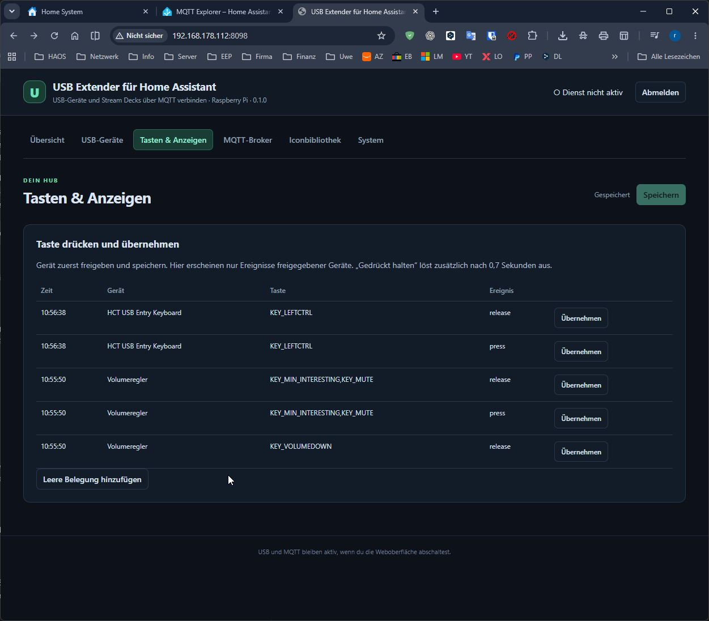
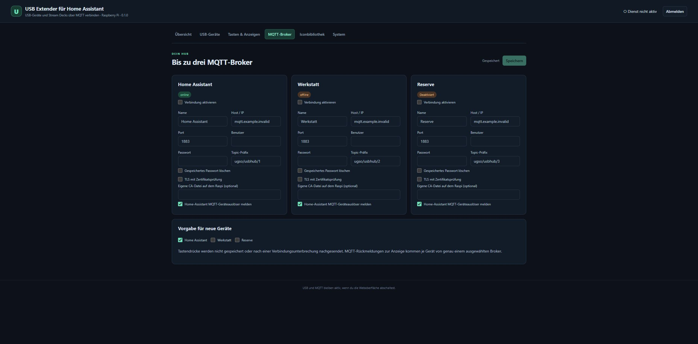

# Prüfungen

## 0.1.5 – Umschalter, Button-Gesten und breite Liste

61 Python-Prüfungen und beide JavaScript-Prüfläufe lokal erfolgreich.

- Reale Paho-/TCP-Verbindungen zu zwei isolierten MQTT-Testbrokern: Switch
  liefert ON beim ersten Druck und OFF beim zweiten. Loslassen und native
  Wiederholungen toggeln nicht. `/state` liefert parallel ON/OFF bei Drücken/Loslassen.
- App-Neuinitialisierung und neue MQTT-Verbindungen lesen den gespeicherten
  Switch-Wert zurück; der nächste Druck schaltet korrekt weiter. Konfiguration bleibt gleich.
- Klick erst nach Doppelklick-Fenster; Doppelklick ohne Einzelklick, Hold einmalig
  ohne Klick beim Loslassen. Verspätete zweite Klicks, gehaltene zweite Betätigung,
  native Repeat-Ereignisse, unabhängige Geräte und eigene Zeitwerte geprüft.
- `/button`, `/button-plus` und einzelne Gesten-Topics liefern einfache Werte.
  Button+ wird leer zurückgesetzt; keine Datenmeldung retained.
- Anlernmodus und bekannte Geräteverluste verwerfen wartende Gesten, ohne den
  gespeicherten Switch umzuschalten.
- 15 Discovery-Komponenten einer voll aktivierten Taste (13 Geräteauslöser,
  zwei Binärsensoren) mit einer Gerätekennung; Type/Subtype-Paare eindeutig.
- DOM-Ablauf prüft neue Topicvorgaben, Speichern und echte CSS-Regel für die volle
  Breite. Syntaxprüfung und `git diff --check` erfolgreich.

Kein physischer Pi-/HA-/ioBroker-Nachtest und keine visuelle Browserabnahme der
neuen Fassung. Die Discovery-Auslöser verwenden die dokumentierten
[HA-Geräteauslöser](https://www.home-assistant.io/integrations/device_trigger.mqtt/).

## 0.1.4 – Lesbare Topics und Gerätezuordnung

47 Python-Prüfungen und beide JavaScript-Prüfläufe lokal erfolgreich.

- Namen mit Umlauten, gleichen Schreibweisen und späterer Umbenennung geprüft:
  lesbare Zähler statt Hashes; gespeicherter Topic-Namensraum bleibt stabil.
- Zwei TCP-MQTT-Testbroker empfangen dieselben fünf lesbaren Topics.
  Nur `press-plus` und `release-plus` erhalten anschließend leere Nutzdaten;
  normale Press/Release und Switch bleiben unverändert. Keine Retain-Markierung.
- Discovery für zwei Tasten: acht verschiedene Geräteauslöser und zwei
  Binärsensoren tragen identischen Gerätenamen und identische Gerätekennung.
- DOM-Anlernablauf zeigt die fertigen lesbaren Topics einschließlich der beiden
  Plus-Kanäle bereits vor dem Speichern an und speichert sie unverändert.
- Vorhandene 0.1.3-Belegungen und deren MQTT-Verhalten werden weiter geprüft.

Kein physischer Pi-/HA-/ioBroker-Nachtest dieser Fassung. Referenz für die
Gerätezuordnung: [Home Assistant MQTT](https://www.home-assistant.io/integrations/mqtt/).

## 0.1.3 – Anlernmodus und Tastenliste

44 Python-Prüfungen sowie die beiden JavaScript-Prüfläufe sind lokal erfolgreich.
Syntaxprüfung beider Skripte und `git diff --check` ebenfalls erfolgreich.
Der DOM-Test umfasst auch eine erst beim Beenden sichtbare letzte Taste.

Lokale Prüfung mit isolierten Konfigurationen und TCP-MQTT-Testbrokern:

- Press → ON → Leer-Rücksetzung sowie Release → OFF → Leer-Rücksetzung in der
  richtigen Reihenfolge auf zwei echten Paho-Verbindungen; nichts retained.
- Schnell aufeinanderfolgende Press+-Meldungen haben eine leere Trennmeldung.
- Kanal-/Zeilen-Deaktivierung und individuelle Brokerwahl greifen.
- HA-Discovery enthält ON/OFF-Binärsensor und gefilterte Press/Release-Auslöser.
- Lautstärkewiederholung startet nach dem Zeitlimit und endet beim Loslassen;
  Switch und Release werden nicht wiederholt. Anlernen unterdrückt den Versand.
- Anlernsitzungen benötigen ein freigegebenes Gerät, Fremdsitzungen sind gesperrt;
  abgelaufene Sitzungen pausieren keine Eingaben mehr.
- Speichern/erneutes Laden erhält neue Zeilen, alte Einzelbelegungen und Passwörter.
- Authentifizierter HTTP-Anlernzyklus verändert die gespeicherte Konfiguration nicht.
- JavaScript prüft Sitzungsfilter, Duplikate, bestehende Zuordnungen und Medienvorgaben.
- DOM-Bedientest: Anlernen → Liste → Beenden → Übernehmen → Speichern → Bearbeiten.

Keine physische Prüfung dieser neuen Fassung auf .112 und kein behaupteter
ioBroker-Empfangsnachweis. Das bleibt ein eigener Live-Nachtest.

## 0.1.2 – MQTT-Versand und Discovery pro Broker

**35 lokale Prüfungen erfolgreich.** Zusätzliche lokale TCP-/Paho-Prüfungen:

- Neue Profile starten mit Discovery aus; Daten erreichen trotzdem alle drei Broker.
- Ohne vorherige Discovery werden weder HA-Ankündigungen veröffentlicht noch
  `homeassistant/status` abonniert.
- Ein absichtlich ausgelöster lokaler Discovery-Fehler unterbricht den MQTT-
  Netzwerkprozess nicht; Eingaben erreichen weiterhin alle drei Testbroker.
- Ausschalten auf einem verbundenen Broker nimmt dessen eigene retained Konfiguration
  zurück; die anderen Broker bleiben davon unberührt.
- Nach Wiederverbindung werden alte eigene Konfigurationen anhand des lokalen
  Discovery-Verzeichnisses zurückgenommen; keine neuen Definitionen bei Discovery aus.
- Migration von 0.1.0/0.1.1 über Konfigurationssicherungen ebenfalls geprüft.
- `key:tab` und `key_tab` werden zu `KEY_TAB`, `key:0` bleibt eine Stream-Deck-Kennung.
- Diagnose unterscheidet erfolgreiche MQTT-Übergabe, fehlende Belegung, fehlende
  Ziele und getrennten Broker und enthält die tatsächlichen Topics.

Live auf dem Raspi mit noch installierter 0.1.0:

1. Gespeicherte Belegung enthielt `key:tab`; Eingabetabelle zeigte `KEY_TAB`.
2. Auf `KEY_TAB` korrigiert, gespeichert; automatische Konfigurationssicherung.
3. Discovery nur im Brokerplatz IOB ausgeschaltet und gespeichert.
4. Nutzer drückte dreimal Tab auf der Trust-Tastatur.
5. Offener MQTT Explorer am HA-Broker zeigte genau drei Nachrichten auf
   `ugso/usbhub/1/event/145f-02c9-378b5b8d2956/847173d76d5d524f4a4c0210961fbacf`.

Bestätigte Payload:

```json
{"device":"145f-02c9-378b5b8d2956","control":"KEY_TAB","event_type":"press","value":1}
```

Der Empfang direkt im ioBroker-Broker und das vollständige 0.1.2-Update auf dem
Raspi sind noch nicht bestätigt. Der ioBroker-Brokerplatz wird als online angezeigt.

Die [Linux-CI für 49a96c0](https://github.com/rockbaer2007/usb-extender-home-assistant/actions/runs/44894647551)
ist vollständig grün: 35 Prüfungen, native SVG-Verarbeitung, Installer, systemd,
Webstart/-stopp und ZIP-Erstellung. Ein zusätzlicher lokaler Browsertest der neuen
Discovery-Auswahl wurde von der Computersteuerung abgebrochen, weil sie die
aktuelle URL nicht verlässlich erkennen konnte. Für die neue Oberfläche wird
deshalb kein erfolgreicher visueller Nachtest behauptet.

## 0.1.1 – Tastaturberechtigungen und Statusanzeige

Lokaler Gesamtlauf: **28 Prüfungen erfolgreich**, einschließlich Statusprüfung mit abweichender
PC-Uhr und Vereinheitlichung von evdev-Aliaslisten/-tupeln. Bash- und
JavaScript-Syntaxprüfung erfolgreich.

Auf dem Raspi wurde im angemeldeten Browser festgestellt:

- HCT USB Entry Keyboard, Arduino Micro und Trust Keyboard werden erkannt.
- MQTT-Broker 1 ist online, der Kernprozess läuft.
- Freigegebene Eingabekanäle melden `Permission denied`.
- Nach dem vom Nutzer ausgeführten Befehl zum Sichern, Ergänzen der Gruppe `input`
  und Neustarten des Kernprozesses: neue Prozess-ID, **keine Gerätefehler mehr**,
  MQTT weiterhin online. Keine Belegungen oder Einstellungen geändert.
- Physische Eingaben in der Liveansicht bestätigt: HCT USB Entry Keyboard
  `KEY_LEFTCTRL` mit press/release sowie Volumeregler mit Lautstärke− und Stumm.
- Stumm wurde von 0.1.0 als Alias-Paar angezeigt. 0.1.1 normalisiert dieses Paar
  zu `KEY_MUTE`; der Regressionstest erhält auch bestehende Alias-Zuordnungen.

Die Korrektur für den Installer nimmt die Standardgruppe `input` auf und erhält
sie in der udev-Regel. Die Statusanzeige verwendet die Uhr des Raspi statt der
PC-Uhr. Auf dem Raspi ist während dieser Diagnose noch 0.1.0 installiert.

Auch die [Linux-CI für 9623d8b](https://github.com/rockbaer2007/usb-extender-home-assistant/actions/runs/44892114882)
ist grün: alle 28 Prüfungen, native Bibliotheken, vollständiger Installer und
Dienstprüfung. Zusätzlich konnte das Dienstkonto eine nur für root und die Gruppe
`input` lesbare Testdatei tatsächlich öffnen. Damit ist die Gruppenmitgliedschaft
unter Linux geprüft; der reale Tastatur-Nachtest erfolgte wie oben beschrieben.



## Bestätigte Basis 0.1.0

Datum: 21. November 2026. Lokale Windows-Prüfung mit Python 3.13.14.

## Automatisierte Prüfung

`python -m unittest discover -v`

**26 Prüfungen erfolgreich**, lokal und in der Linux-CI, einschließlich
identischer Spiegelung zu mehreren Brokern.

- Konfigurationsversion und genau drei Brokerplätze; Passwort-Hash,
  ausgeblendete Zugangsdaten und Erhalt gespeicherter MQTT-Passwörter.
- Atomare Speicherung und Begrenzung auf zehn Konfigurationssicherungen.
- Zielvorrang Belegung → Gerät → Standard; stabile USB-Identität und Port-Fallback.
- Zuordnung zweier Stream Decks ohne USB-Seriennummer über libusb-Pfade.
- Drei echte Paho-MQTT-Clients über lokale TCP-Verbindungen zu isolierten
  MQTT-3.1.1-Testgegenstellen. Ereignisse erreichen alle drei Ziele ohne retained.
- Festes Sende-Topic an allen drei Brokern: Topic und Payload sind bytegleich.
- Ausfall einer Gegenstelle beeinträchtigt die anderen zwei nicht.
- Fehlerhafte CA-Datei eines Brokers blockiert die übrigen Verbindungen nicht.
- Zustandsabonnement am ausgewählten Empfangsbroker und Wiederholung der
  Discovery nach Home-Assistant-Birth-Nachricht.
- Retained-Discovery-Löschung für eine entfernte Belegung bei verbundenen Brokern.
- Ordnerimport, normalisierte PNG-Ausgabe und Vermeidung identischer Bibliothekseinträge.
- `.streamDeckIconPack`-Testarchiv in offizieller Verzeichnisstruktur mit Namen,
  Tags, Autor und Lizenztext; gefährliche Archivpfade und aktive/externe SVG-Inhalte
  werden abgelehnt. GIF verwendet das erste Bild.
- Native Stream-Deck-JPEG-Aufbereitung mit Icon, Text und Helligkeit an einem
  Testobjekt; ungültige Tastennummer erzeugt keinen Bildauftrag.
- HTTP-Anmeldung, Zugriffsschutz, Fremdursprungs-Abweisung, Konfigurationsspeicherung,
  Iconupload und Sitzungsbeendigung.
- Getrennte Web-/USB-MQTT-Prozesse: Webprozess beendet, dessen TCP-Port geschlossen,
  Kernprozess schreibt weiterhin Status. Kernprozess neu gestartet, gespeicherte
  Gerätezuordnung bleibt erhalten.

Die MQTT-Gegenstellen sind eigene lokale Protokoll-Testserver, kein bestätigter
Test mit Mosquitto oder einer echten Home-Assistant-Instanz.

## Chrome

Lokale Oberfläche `http://127.0.0.1:8098` mit ausdrücklich künstlichen Beispieldaten:

- Anmeldung und vollständige Darstellung der drei MQTT-Karten.
- Tastenbelegung geändert, gespeichert, nach Neuladen vorhanden.
- Dieselbe Belegung erneut geändert und zweimal gespeichert; anschließend
  Speicherzustand wieder grau/deaktiviert.
- Iconbibliothek mit Vorschaubildern, Namen, Sammlung sowie Lizenz-/ID-Details.
- Keine beobachteten Anwendungs-JavaScriptfehler; Browsererweiterungen meldeten
  eigene, nicht aus dieser Anwendung stammende Fehler.




## Paket und Installer

- Bash-Syntaxprüfung für Installer und CLI-Starter.
- JavaScript-Syntaxprüfung, Python-Kompilierung und Python-Paketinstallation.
- ZIP-Prüfung mit SHA-256-Dateiliste, LF-Zeilenenden und Linux-Ausführungsrechten.
- Keine lokalen Konfigurationen, Passwörter, venv, Git-Daten oder erworbenen Iconpacks
  im Auslieferungspaket.

## Noch nicht bestätigt

- Ausführung des Installers auf Raspberry Pi OS und tatsächliche ARM-Abhängigkeiten.
- Physische USB-/Stream-Deck-Geräte, Hotplug und Stromversorgung am Pi.
- HA-Geräteauslöser und Anzeigezustände mit der tatsächlichen HA-Installation.
- Alle Varianten realer Elgato-Marketplace-Iconpacks sowie Animationen.

## Linux-CI

Die Linux-CI unter Ubuntu 24.04 / Python 3.11 ist erfolgreich:
[Linux-Prüfung für 2432764](https://github.com/rockbaer2007/usb-extender-home-assistant/actions/runs/44889742734).

- Native Bibliotheken und Linux-Python-Abhängigkeiten installiert, einschließlich evdev.
- Gesamttests, echte SVG-Rasterung und ZIP-Erstellung erfolgreich.
- `sudo bash install.sh` auf der isolierten Linux-VM vollständig ausgeführt.
- CLI-Versionsanzeige 0.1.0; USB-/MQTT-Dienst aktiv; systemd-Units geprüft.
- Weboberfläche gestartet und HTML erfolgreich abgerufen; Konfigurations-API
  ohne Anmeldung wie vorgesehen mit HTTP 401 abgewiesen.
- Weboberfläche gestoppt, HTTP-Port geschlossen; USB-/MQTT-Dienst weiterhin aktiv.
- Kernprozess über systemd neu gestartet und danach wieder aktiv.

Der Installationslauf enthält alle 26 Gesamttests und die native USB-Bibliotheksprüfung.
Ein Linux-x86-VM-Test ersetzt keinen Raspberry-Pi-/USB-Hardwaretest.
