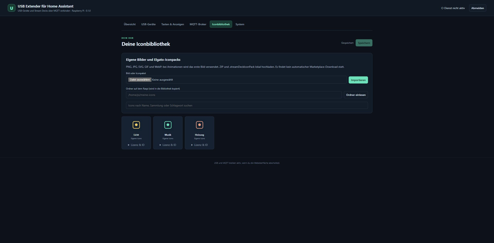

# Prüfungen

## 0.1.1 – Tastaturberechtigungen und Statusanzeige

Lokaler Gesamtlauf: **28 Prüfungen erfolgreich**, einschließlich Statusprüfung mit abweichender
PC-Uhr und Vereinheitlichung von evdev-Aliaslisten/-tupeln. Bash- und
JavaScript-Syntaxprüfung erfolgreich.

Auf dem Raspi wurde im angemeldeten Browser festgestellt:

- HCT USB Entry Keyboard, Arduino Micro und Trust Keyboard werden erkannt.
- MQTT-Broker 1 ist online, der Kernprozess läuft.
- Freigegebene Eingabekanäle melden `Permission denied`.
- Nach dem vom Nutzer ausgeführten Befehl zum Sichern, Ergänzen der Gruppe `input`
  und Neustarten des Kernprozesses: neue Prozess-ID, **keine Gerätefehler mehr**,
  MQTT weiterhin online. Keine Belegungen oder Einstellungen geändert.
- Physische Eingaben in der Liveansicht bestätigt: HCT USB Entry Keyboard
  `KEY_LEFTCTRL` mit press/release sowie Volumeregler mit Lautstärke− und Stumm.
- Stumm wurde von 0.1.0 als Alias-Paar angezeigt. 0.1.1 normalisiert dieses Paar
  zu `KEY_MUTE`; der Regressionstest erhält auch bestehende Alias-Zuordnungen.

Die Korrektur für den Installer nimmt die Standardgruppe `input` auf und erhält
sie in der udev-Regel. Die Statusanzeige verwendet die Uhr des Raspi statt der
PC-Uhr. Auf dem Raspi ist während dieser Diagnose noch 0.1.0 installiert.

## Bestätigte Basis 0.1.0

Datum: 21. November 2026. Lokale Windows-Prüfung mit Python 3.13.14.

## Automatisierte Prüfung

`python -m unittest discover -v`

**26 Prüfungen erfolgreich**, lokal und in der Linux-CI, einschließlich
identischer Spiegelung zu mehreren Brokern.

- Konfigurationsversion und genau drei Brokerplätze; Passwort-Hash,
  ausgeblendete Zugangsdaten und Erhalt gespeicherter MQTT-Passwörter.
- Atomare Speicherung und Begrenzung auf zehn Konfigurationssicherungen.
- Zielvorrang Belegung → Gerät → Standard; stabile USB-Identität und Port-Fallback.
- Zuordnung zweier Stream Decks ohne USB-Seriennummer über libusb-Pfade.
- Drei echte Paho-MQTT-Clients über lokale TCP-Verbindungen zu isolierten
  MQTT-3.1.1-Testgegenstellen. Ereignisse erreichen alle drei Ziele ohne retained.
- Festes Sende-Topic an allen drei Brokern: Topic und Payload sind bytegleich.
- Ausfall einer Gegenstelle beeinträchtigt die anderen zwei nicht.
- Fehlerhafte CA-Datei eines Brokers blockiert die übrigen Verbindungen nicht.
- Zustandsabonnement am ausgewählten Empfangsbroker und Wiederholung der
  Discovery nach Home-Assistant-Birth-Nachricht.
- Retained-Discovery-Löschung für eine entfernte Belegung bei verbundenen Brokern.
- Ordnerimport, normalisierte PNG-Ausgabe und Vermeidung identischer Bibliothekseinträge.
- `.streamDeckIconPack`-Testarchiv in offizieller Verzeichnisstruktur mit Namen,
  Tags, Autor und Lizenztext; gefährliche Archivpfade und aktive/externe SVG-Inhalte
  werden abgelehnt. GIF verwendet das erste Bild.
- Native Stream-Deck-JPEG-Aufbereitung mit Icon, Text und Helligkeit an einem
  Testobjekt; ungültige Tastennummer erzeugt keinen Bildauftrag.
- HTTP-Anmeldung, Zugriffsschutz, Fremdursprungs-Abweisung, Konfigurationsspeicherung,
  Iconupload und Sitzungsbeendigung.
- Getrennte Web-/USB-MQTT-Prozesse: Webprozess beendet, dessen TCP-Port geschlossen,
  Kernprozess schreibt weiterhin Status. Kernprozess neu gestartet, gespeicherte
  Gerätezuordnung bleibt erhalten.

Die MQTT-Gegenstellen sind eigene lokale Protokoll-Testserver, kein bestätigter
Test mit Mosquitto oder einer echten Home-Assistant-Instanz.

## Chrome

Lokale Oberfläche `http://127.0.0.1:8098` mit ausdrücklich künstlichen Beispieldaten:

- Anmeldung und vollständige Darstellung der drei MQTT-Karten.
- Tastenbelegung geändert, gespeichert, nach Neuladen vorhanden.
- Dieselbe Belegung erneut geändert und zweimal gespeichert; anschließend
  Speicherzustand wieder grau/deaktiviert.
- Iconbibliothek mit Vorschaubildern, Namen, Sammlung sowie Lizenz-/ID-Details.
- Keine beobachteten Anwendungs-JavaScriptfehler; Browsererweiterungen meldeten
  eigene, nicht aus dieser Anwendung stammende Fehler.

## Paket und Installer

- Bash-Syntaxprüfung für Installer und CLI-Starter.
- JavaScript-Syntaxprüfung, Python-Kompilierung und Python-Paketinstallation.
- ZIP-Prüfung mit SHA-256-Dateiliste, LF-Zeilenenden und Linux-Ausführungsrechten.
- Keine lokalen Konfigurationen, Passwörter, venv, Git-Daten oder erworbenen Iconpacks
  im Auslieferungspaket.

## Noch nicht bestätigt

- Ausführung des Installers auf Raspberry Pi OS und tatsächliche ARM-Abhängigkeiten.
- Physische USB-/Stream-Deck-Geräte, Hotplug und Stromversorgung am Pi.
- HA-Geräteauslöser und Anzeigezustände mit der tatsächlichen HA-Installation.
- Alle Varianten realer Elgato-Marketplace-Iconpacks sowie Animationen.

## Linux-CI

Die Linux-CI unter Ubuntu 24.04 / Python 3.11 ist erfolgreich:
[Linux-Prüfung für 2432764](https://github.com/rockbaer2007/usb-extender-home-assistant/actions/runs/44889742734).

- Native Bibliotheken und Linux-Python-Abhängigkeiten installiert, einschließlich evdev.
- Gesamttests, echte SVG-Rasterung und ZIP-Erstellung erfolgreich.
- `sudo bash install.sh` auf der isolierten Linux-VM vollständig ausgeführt.
- CLI-Versionsanzeige 0.1.0; USB-/MQTT-Dienst aktiv; systemd-Units geprüft.
- Weboberfläche gestartet und HTML erfolgreich abgerufen; Konfigurations-API
  ohne Anmeldung wie vorgesehen mit HTTP 401 abgewiesen.
- Weboberfläche gestoppt, HTTP-Port geschlossen; USB-/MQTT-Dienst weiterhin aktiv.
- Kernprozess über systemd neu gestartet und danach wieder aktiv.

Der Installationslauf enthält alle 26 Gesamttests und die native USB-Bibliotheksprüfung.
Ein Linux-x86-VM-Test ersetzt keinen Raspberry-Pi-/USB-Hardwaretest.
